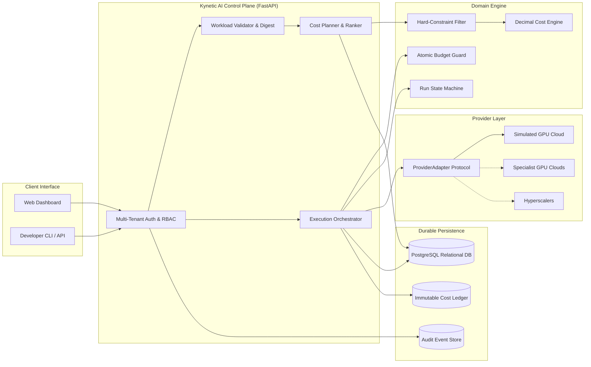
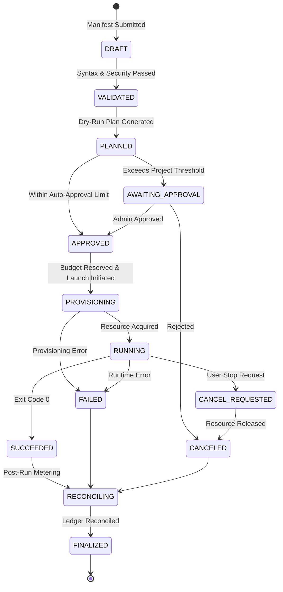

<div align="center">

# ⚡ Kynetic AI (GCIN)
### Global Compute Intelligence Network & Workload Orchestration Engine

*Run the right workload on the right infrastructure, with transparent cost and measurable outcomes.*

[](https://www.python.org/)
[](https://fastapi.tiangolo.com/)
[](https://www.postgresql.org/)
[](https://www.sqlalchemy.org/)
[](https://alembic.sqlalchemy.org/)
[](https://docs.pytest.org/)
[](https://pytest-cov.readthedocs.io/)

</div>

---

## 🌟 Overview

**Kynetic AI** is a software-first multi-provider compute scheduling and workload orchestration platform. Instead of acting as a static GPU price board or owning capital-intensive data centres, Kynetic AI operates as an **intelligent compute scheduler with a marketplace attached**.

Developers and engineering teams specify outcomes and constraints—such as GPU memory floor, budget limits, execution deadlines, data residency, and checkpointing rules. Kynetic AI evaluates compatible compute options across independent GPU clouds, estimates total cost-to-completion, generates side-effect-free dry-run plans, and coordinates reliable, auditable execution.



---

## 🚀 Key Differentiating Capabilities

### 1. Workload Performance Digital Twin (Phase 2)
Predicts runtime, throughput, compatibility, and cost ranges with explicit uncertainty based on benchmark evidence and hardware metadata. Never hallucinates artificial precision.

### 2. Predictive Compute Arbitrage (Phase 4)
Evaluates in-progress jobs at safe task boundaries and proposes approved migrations only when remaining net savings justify migration overhead, startup latency, and failure risk.

### 3. Universal Checkpoint & Resume Abstraction (Phase 3)
Provides workload-specific adapters (PyTorch, DeepSpeed) that validate checkpoint integrity, encryption, and compatibility prior to target restoration.

---

## ⚙️ Architecture & Safety Principles



1. **Two-Stage Candidate Selection:**
   - **Stage A (Hard Constraints):** Filter incompatible hardware, regions, disallowed providers, budget ceilings, and stale pricing. Rejection reasons are recorded explicitly.
   - **Stage B (Scoring & Ranking):** Rank eligible candidates by total cost-to-completion, hardware affinity, and duration.
2. **Side-Effect-Free Planning:** Plan preview and cost estimation never provision provider resources or incur billable charges.
3. **Atomic Budget Reservation:** Concurrent launches cannot bypass spend limits; budget holds are acquired within a transactional lock.
4. **Request Idempotency:** Billable mutations require an `Idempotency-Key`. Retries return existing resources without duplicate instance creation.
5. **Exact Financial Mathematics:** All money is computed and persisted using `Decimal` and SQL `Numeric(14, 4)`. Floating-point rounding is strictly forbidden.
6. **Zero Plaintext Secrets:** Cloud provider credentials are never stored in database tables or logs. Records hold opaque `secret_reference` identifiers, and all log emissions are scrubbed with an automated JSON secret redactor.

---

## 📁 Repository Structure

```text
.
├── backend/
│   ├── app/
│   │   ├── main.py                     # FastAPI application factory & middleware
│   │   ├── api/
│   │   │   ├── deps.py                 # Auth context, RBAC & tenant scoping
│   │   │   └── v1/                     # REST API endpoints
│   │   │       ├── health.py           # /health/live & /health/ready
│   │   │       ├── organizations.py    # /v1/organizations & memberships
│   │   │       ├── projects.py         # /v1/projects & policy controls
│   │   │       ├── providers.py        # /v1/providers & compute offers
│   │   │       ├── workloads.py        # /v1/workloads & manifest validation
│   │   │       ├── planning.py         # /v1/workloads/{id}/plans (dry-run)
│   │   │       ├── runs.py             # /v1/plans/{id}/launch, runs, logs
│   │   │       ├── checkpoints.py      # /v1/runs/{id}/checkpoints & resumption
│   │   │       ├── arbitrage.py        # /v1/runs/{id}/arbitrage (scan, approve, execute)
│   │   │       ├── ledger.py           # /v1/runs/{id}/cost & reconciliation
│   │   │       └── audit.py            # /v1/audit-events
│   │   ├── core/
│   │   │   ├── config.py               # Pydantic BaseSettings & env validation
│   │   │   ├── security.py             # RBAC matrices & API token verification
│   │   │   ├── logging.py              # Structured JSON logging & secret redactor
│   │   │   └── errors.py               # Domain exceptions & error envelope
│   │   ├── domain/
│   │   │   ├── common.py               # Money (Decimal), Currency, SourceType
│   │   │   ├── workloads/manifest.py   # WorkloadManifest, digest & fingerprint
│   │   │   ├── planning/
│   │   │   │   ├── cost_engine.py      # Transparent cost engine with unknown flags
│   │   │   │   └── candidate_evaluator.py # Two-stage selection & ranking
│   │   │   └── execution/
│   │   │       └── state_machine.py    # Validated RunStateMachine lifecycle
│   │   ├── ports/
│   │   │   └── provider_adapter.py     # Neutral ProviderAdapter Protocol
│   │   └── adapters/
│   │       ├── persistence/
│   │       │   ├── database.py         # SQLAlchemy async engine & sessionmaker
│   │       │   └── models.py           # 18 relational models with foreign keys
│   │       └── providers/
│   │           ├── registry.py         # Dynamic ProviderRegistry factory & offer aggregator
│   │           ├── base.py             # Resilient HTTP provider client with secret scrubber
│   │           ├── runpod_adapter.py   # RunPod GPU cloud adapter
│   │           ├── lambda_adapter.py   # Lambda Labs on-demand GPU adapter
│   │           ├── aws_adapter.py      # AWS EC2 GPU adapter (p5, p4de, g5)
│   │           ├── gcp_adapter.py      # GCP Compute Engine GPU adapter (a3, a2, g2)
│   │           ├── azure_adapter.py    # Azure VM GPU adapter (NDv5, NC-series)
│   │           └── fake_provider.py    # Deterministic simulated provider adapter
│   ├── migrations/                     # Alembic migration environment
│   │   ├── env.py
│   │   └── versions/
│   │       └── 10e28eca61ee_initial_schema.py
│   ├── tests/
│   │   ├── conftest.py                 # Async test fixtures & in-memory DB
│   │   ├── unit/                       # Manifest, cost engine, evaluator, state machine
│   │   ├── integration/                # Provider contract & cross-tenant isolation
│   │   └── e2e/                        # End-to-end vertical slice test
│   ├── pyproject.toml                  # Python package manifest
│   ├── alembic.ini                     # Alembic configuration
│   ├── .env.example                    # Safe environment template
│   ├── Dockerfile                      # Production container image
│   └── README.md                       # Backend guide
├── frontend/                           # Client interface (React 19 + TypeScript + Vite)
│   ├── public/
│   │   └── assets/
│   │       └── Kynetic AI Logo.png     # Official Kynetic AI brand mark
│   ├── src/
│   │   ├── components/                 # Navbar, Footer, EarlyAccessModal
│   │   ├── pages/                      # HomePage, DashboardPage, WorkloadPlannerPage, RecommendationsPage, ProvidersPage, ArchitecturePage, DocsPage, EarlyAccessPage, MobileHomePage
│   │   ├── App.tsx                     # Client-side routing with unified Olive Green theme
│   │   ├── index.css                   # Monastic brutalist styles & custom tokens
│   │   └── main.tsx                    # React DOM entry point
│   ├── package.json                    # Frontend dependencies
│   ├── tailwind.config.js              # Olive Green design token configuration
│   └── README.md                       # Frontend guide
├── docs/
│   ├── IMPLEMENTATION_STATUS.md        # Technical verification & milestone record
│   ├── Kynetic_AI_Architecture.md     # Comprehensive engineering blueprint
│   ├── Kynetic_AI_Complete_Overview.md # Product strategy & thesis
│   ├── Kynetic_AI_PRD_v1.1.md         # Product requirements document
│   └── Kynetic_AI_TRD.md              # Technical requirements document
├── .gitignore
└── README.md
```

---

## 🛠️ Quickstart

### 1. Backend Quickstart (FastAPI Control Plane)

#### Prerequisites
- Python 3.11 or 3.12
- PostgreSQL 14+ (or SQLite for local zero-dependency testing)

```bash
cd backend

# Create and activate virtual environment
python3.12 -m venv .venv
source .venv/bin/activate

# Install dependencies in editable mode
pip install --upgrade pip setuptools
pip install -e ".[dev]"

# Copy environment configuration
cp .env.example .env

# Run Database Migrations
alembic upgrade head

# Start the Backend Server
uvicorn app.main:app --reload --port 8000
```

- **Interactive Swagger UI:** [http://localhost:8000/docs](http://localhost:8000/docs)
- **ReDoc:** [http://localhost:8000/redoc](http://localhost:8000/redoc)
- **OpenAPI Schema:** [http://localhost:8000/openapi.json](http://localhost:8000/openapi.json)

---

### 2. Frontend Quickstart (React 19 + TypeScript)

#### Prerequisites
- Node.js 18+ or 20+
- npm or pnpm

```bash
cd frontend

# Install dependencies
npm install

# Start local dev server
npm run dev
```

- **Local Web App:** [http://localhost:5173](http://localhost:5173)
- **Production Build:** `npm run build`
- **Build Preview:** `npm run preview`


---

## 🧪 Automated Testing & Coverage

Run the complete test suite with coverage report:

```bash
pytest -v --cov=app --cov-report=term-missing
```

### Test Suite Summary

```text
============================= test session starts ==============================
collected 13 items

tests/e2e/test_vertical_slice.py .                                       [  7%]
tests/integration/test_provider_contract.py .                            [ 15%]
tests/integration/test_tenant_isolation.py .                             [ 23%]
tests/unit/test_candidate_evaluator.py .                                 [ 30%]
tests/unit/test_cost_engine.py ...                                       [ 53%]
tests/unit/test_manifest.py ...                                          [ 76%]
tests/unit/test_state_machine.py ...                                     [100%]

============================== 41 passed in 0.20s ==============================
Total Coverage: 72%
```

---

## 📜 Key API Reference

| Method | Endpoint | Description |
|---|---|---|
| `GET` | `/health/live` | Process health probe |
| `GET` | `/health/ready` | Database connectivity readiness probe |
| `POST` | `/v1/organizations` | Create tenant organization |
| `POST` | `/v1/projects` | Create project with policy and spend limits |
| `GET` | `/v1/providers` | List providers and capability profiles (RunPod, Lambda, AWS, GCP, Azure, Simulated) |
| `GET` | `/v1/compute-offers` | List normalized GPU offers (H100, A100, L40S, RTX 4090, GH200) across all clouds |
| `POST` | `/v1/provider-connections` | Register provider account (`secret_reference` only, never plaintext) |
| `POST` | `/v1/provider-connections/{id}/verify` | Test live credential authentication with external cloud provider |
| `POST` | `/v1/providers/{key}/sync-offers` | Synchronize fresh GPU catalog and spot/on-demand offers |
| `POST` | `/v1/workloads/validate-manifest` | Validate manifest syntax, security, and derive fingerprint |
| `POST` | `/v1/workloads` | Create workload and immutable revision 1 |
| `POST` | `/v1/workloads/{id}/plans` | Generate side-effect-free dry-run plan |
| `GET` | `/v1/plans/{id}` | Inspect plan, candidate ranks, and explanations |
| `POST` | `/v1/plans/{id}/approve` | Approve plan requiring administrative review |
| `POST` | `/v1/benchmarks` | Ingest empirical benchmark observation into Digital Twin registry |
| `GET` | `/v1/benchmarks` | Query empirical benchmarks by workload fingerprint or GPU model |
| `POST` | `/v1/workloads/{id}/predict` | Predict runtime and cost with calibrated uncertainty intervals |
| `GET` | `/v1/workloads/{id}/prediction-history` | Audit prediction log for a workload |
| `POST` | `/v1/predictions/{id}/outcome` | Ingest actual run telemetry and track error % & interval coverage |
| `POST` | `/v1/plans/{id}/launch` | Launch run from plan (enforces `Idempotency-Key` and budget hold) |
| `GET` | `/v1/runs/{id}` | Retrieve run lifecycle status and append-only state events |
| `POST` | `/v1/runs/{id}/cancel` | Gracefully cancel run and release compute resources |
| `GET` | `/v1/runs/{id}/logs` | Stream container logs from provider |
| `POST` | `/v1/runs/{id}/checkpoints` | Register saved checkpoint (SHA-256 digest, URI, size) |
| `GET` | `/v1/runs/{id}/checkpoints` | List checkpoints for a run ordered by step desc |
| `GET` | `/v1/checkpoints/{id}` | Inspect checkpoint details and verification status |
| `POST` | `/v1/checkpoints/{id}/verify` | Deep verify checksum, header integrity & target VRAM fit |
| `POST` | `/v1/checkpoints/{id}/estimate-transfer` | Model cross-cloud egress fees & migration downtime |
| `POST` | `/v1/checkpoints/{id}/resume` | Resume run on compatible target (idempotent, OOM guard) |
| `POST` | `/v1/runs/{id}/arbitrage/scan` | Scan in-flight run for arbitrage opportunities with anti-oscillation guards |
| `GET` | `/v1/runs/{id}/arbitrage/opportunities` | List identified opportunities with net savings calculations |
| `POST` | `/v1/arbitrage/opportunities/{id}/approve` | Approve arbitrage opportunity for execution |
| `POST` | `/v1/arbitrage/opportunities/{id}/execute` | Execute in-flight migration to cheaper provider instance |
| `GET` | `/v1/runs/{id}/cost` | Inspect cost ledger (estimates vs actuals) |
| `POST` | `/v1/runs/{id}/reconcile` | Append actual usage observation to immutable ledger |
| `GET` | `/v1/audit-events` | Query tenant audit events |


---

## 📖 Authoritative Project Documentation

For deeper architectural context and specifications, consult the documents in `/docs`:
- [IMPLEMENTATION_STATUS.md](file:///Users/divyebhatnagar/Desktop/KYNETICNEWINTELLIGENCE/docs/IMPLEMENTATION_STATUS.md): Complete Phase 1 technical record and verification.
- [Kynetic_AI_Architecture.md](file:///Users/divyebhatnagar/Desktop/KYNETICNEWINTELLIGENCE/docs/Kynetic_AI_Architecture.md): System architecture blueprint and engineering design.
- [Kynetic_AI_Complete_Overview.md](file:///Users/divyebhatnagar/Desktop/KYNETICNEWINTELLIGENCE/docs/Kynetic_AI_Complete_Overview.md): Product thesis, market positioning, and strategy.
- [Kynetic_AI_PRD_v1.1.md](file:///Users/divyebhatnagar/Desktop/KYNETICNEWINTELLIGENCE/docs/Kynetic_AI_PRD_v1.1.md): Product requirements document.
- [Kynetic_AI_TRD.md](file:///Users/divyebhatnagar/Desktop/KYNETICNEWINTELLIGENCE/docs/Kynetic_AI_TRD.md): Technical requirements and release criteria.

---

## ⚖️ License

Distributed under the Apache 2.0 / MIT License.
