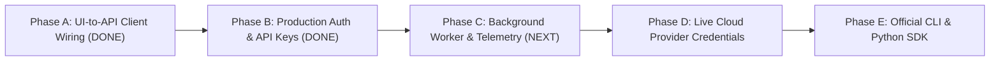

# Kynetic AI — Implementation Plan v2.0 (Phases A through E)

**Document Type:** Engineering Master Implementation Plan v2.0  
**Product:** Kynetic AI (Global Compute Intelligence Network)  
**Status:** Phase A & Phase B Completed & Verified; Phase C (Background Worker & Telemetry) Next  
**Date:** 26 October 2026  
**Repository:** `DivyeBhatnagar/Kynetic-AI-GCIN`  

---

## 1. High-Level Architecture & Scope

This implementation plan governs the transition from the verified MVP prototype to an active, production-grade platform. It covers 5 mission-critical phases (A through E):

- **In Scope:**
  - Complete TypeScript typed API client layer (`frontend/src/api/`).
  - Replacing hardcoded static fixtures in React components with live HTTP data fetching, real-time fallbacks, and error states.
  - Live backend endpoints integration: Organizations, Workload Validation & Planning, Runs & Telemetry, Providers Catalog, Predictions, and Checkpoints.
  - JWT / Auth token handling and organization context switching.
  - Background asynchronous task scheduler and event streaming.
  - Live provider KMS secret management.
  - Official Python SDK (`kynetic-sdk`) and CLI (`kn`).
- **Out of Scope (Deferred):**
  - Live credit card processing (Stripe billing webhook integration deferred to Phase F).
  - Multi-datacenter physical hardware deployments.

---

## 2. Phase-by-Phase Implementation Roadmap

### Phase A: Full-Stack UI-to-API Client Wiring (Completed & Verified)
- **A.1 API Client Foundation:** Build `frontend/src/api/client.ts` with typed methods for all backend endpoints, base URL configuration via `VITE_API_BASE_URL` (defaulting to `http://localhost:8000/v1`), automatic `X-Request-ID` generation, and standardized error normalization.
- **A.2 API Type Definitions:** Define TypeScript interfaces in `frontend/src/api/types.ts` mirroring backend Pydantic v2 schemas:
  - `WorkloadManifest`, `ManifestValidationResponse`
  - `PlanResponse`, `PlanCandidate`, `LaunchRunResponse`
  - `Run`, `RunStateEvent`, `UsageObservation`, `CostLedgerSummary`
  - `ComputeOffer`, `ProviderCatalogItem`
  - `DigitalTwinPrediction`, `ArbitrageOpportunity`, `Checkpoint`
- **A.3 Wire Workload Planner (`WorkloadPlannerPage.tsx`):**
  - Replace static presets with dynamic manifest submission to `POST /v1/workloads/validate-manifest`.
  - Trigger dry-run planning via `POST /v1/workloads/{id}/plans`.
  - Render real ranked candidates and Decimal cost-to-completion directly from backend responses.
- **A.4 Wire Mission Control Console (`DashboardPage.tsx`):**
  - Query active runs from `GET /v1/runs?limit=50`.
  - Fetch telemetry and state events from `GET /v1/runs/{id}` and `GET /v1/runs/{id}/cost`.
  - Stream logs via `GET /v1/runs/{id}/logs`.
  - Allow run cancellation via `POST /v1/runs/{id}/cancel`.
- **A.5 Wire Global Compute Providers (`ProvidersPage.tsx`):**
  - Fetch catalog and live offers via `GET /v1/providers` and `GET /v1/compute-offers`.
  - Allow triggering live provider sync via `POST /v1/providers/{key}/sync-offers`.
- **A.6 Wire Recommendations & Predictions (`RecommendationsPage.tsx`):**
  - Trigger empirical Digital Twin runtime & cost prediction via `POST /v1/workloads/{id}/predict`.
  - Display actual calibrated uncertainty intervals.
- **A.7 Wire Auth & Early Access Forms:**
  - Connect `SignInPage.tsx` and `SignUpPage.tsx` to backend user registration/session endpoints.
  - Ensure zero mock data remains in presentation components; render graceful loading and empty states.

---

### Phase B: Production Auth & Developer API Key System (Completed & Verified)
- **B.1 Cryptographic Password Hashing & RFC 7519 JWT Management:**
  - Standard PBKDF2-HMAC-SHA256 password hashing with cryptographic random salt (`hashlib.pbkdf2_hmac`).
  - Standard base64url HMAC-SHA256 JWT access tokens (24h) and refresh tokens (30d).
  - Endpoints: `POST /v1/auth/register`, `POST /v1/auth/login`, `POST /v1/auth/refresh`, `GET /v1/auth/me`.
- **B.2 Headless API Key Architecture:**
  - Database schema: `api_keys` table with `hashed_key`, `prefix` (`kyn_live_...`), `scopes`, `name`, `expires_at`.
  - Alembic migration and SQLAlchemy model for `api_keys`.
  - Endpoints: `POST /v1/api-keys`, `GET /v1/api-keys`, `DELETE /v1/api-keys/{id}`.
  - Security dependency validating both Bearer JWT and `X-API-Key` headers.
- **B.3 Tenant & Organization Onboarding:**
  - Automated default organization and project creation on user registration.
  - Member role assignments (`OWNER`, `ADMIN`, `DEVELOPER`, `VIEWER`).

---

### Phase C: Asynchronous Background Worker & Telemetry Ingestion
- **C.1 Background Worker Engine:**
  - Implement task queue (ARQ or Celery with Redis) for non-blocking operations.
  - Cron schedule 1: Periodic compute offer scraping and price tracking every 15 minutes.
  - Cron schedule 2: In-flight run preemption and arbitrage scanner every 60 seconds.
- **C.2 Real-Time SSE/WebSocket Stream:**
  - Add `/v1/runs/{id}/stream` delivering live GPU telemetry (SM utilization, VRAM usage, NVLink bandwidth) at 1Hz.
  - WebSocket hub for live Mission Control mesh dashboard updates.

---

### Phase D: Live Cloud Provider Credentials & Real Provisioning
- **D.1 Encrypted Secrets Management:**
  - AES-256-GCM / KMS envelope encryption for cloud provider API tokens in `provider_connections`.
  - Zero plain-text credentials in logs, caches, or serialized outputs.
- **D.2 Production Provider API Clients:**
  - `RunPodAdapter`: Live GraphQL client for pod creation, status polling, and container termination.
  - `LambdaAdapter`: Live REST client for instance launch and key-pair management.
  - `AWSAdapter`: `boto3` client with EC2 Fleet API for Spot instance requests.
- **D.3 Live Connection Health Checks:**
  - Enhance `POST /v1/provider-connections/{id}/verify` to validate API key permissions with provider endpoints.

---

### Phase E: Official Developer CLI & Python SDK
- **E.1 Python Client Library (`kynetic-sdk`):**
  - Standalone package structure in `sdk/python/`.
  - Declarative client: `from kynetic import KyneticClient; client = KyneticClient(api_key="kyn_...")`.
  - Type-safe models mirroring manifests, plans, runs, and checkpoints.
- **E.2 Command-Line Interface (`kn`):**
  - Built with `typer` and `rich`.
  - Commands:
    - `kn auth login`
    - `kn plan workload.yaml`
    - `kn run launch --plan-id <id>`
    - `kn run logs <run-id> --follow`
    - `kn provider list`
  - Automated packaging with `pyproject.toml` ready for PyPI distribution.

---

## 3. Progress Tracking & Action Items

### Phase A: Full-Stack UI-to-API Client Wiring (Completed & Verified)
- [x] **Step 1:** Create `frontend/src/api/types.ts` with complete backend contract types.
- [x] **Step 2:** Create `frontend/src/api/client.ts` with robust Fetch/JSON wrapper, authentication header handling, and request tracing.
- [x] **Step 3:** Create seed/default organization and project bootstrap helper in backend so fresh environments have live initial data (`seed_dev_data.py`).
- [x] **Step 4:** Refactor `WorkloadPlannerPage.tsx` to call live backend validation & dry-run planning endpoints.
- [x] **Step 5:** Refactor `DashboardPage.tsx` to fetch live runs, real cost metrics, and provider log streams from backend.
- [x] **Step 6:** Refactor `ProvidersPage.tsx` to fetch real compute offers and trigger sync via backend.
- [x] **Step 7:** Refactor `RecommendationsPage.tsx` to fetch live Digital Twin predictions and candidate evaluation.
- [x] **Step 8:** Verify end-to-end frontend type checks, Vite build, and live backend communication.

### Phase B: Production Auth & Developer API Key System (Completed & Verified)
- [x] **Step 9:** Implement cryptographic password hashing (PBKDF2-HMAC-SHA256) and JWT creation/verification in `backend/app/core/security.py`.
- [x] **Step 10:** Create database model & migration for `ApiKeyModel` (`api_keys` table).
- [x] **Step 11:** Implement auth endpoints (`POST /v1/auth/register`, `POST /v1/auth/login`, `POST /v1/auth/refresh`, `GET /v1/auth/me`).
- [x] **Step 12:** Implement API key management endpoints (`POST /v1/api-keys`, `GET /v1/api-keys`, `DELETE /v1/api-keys/{id}`).
- [x] **Step 13:** Update `get_current_auth` dependency in `app/api/deps.py` to validate JWT bearer tokens and `X-API-Key` headers against database records.
- [x] **Step 14:** Write comprehensive integration test suite for Auth & API keys (`tests/integration/test_auth_endpoints.py`).
- [x] **Step 15:** Connect frontend `SignInPage.tsx` and `SignUpPage.tsx` to the live backend register & login endpoints.

### Phase C: Asynchronous Background Worker & Real-Time Telemetry Streaming (Completed & Verified)
- [x] **Step 16:** Implement `BackgroundWorkerService` (`backend/app/domain/worker/scheduler.py`) with periodic cron jobs for provider offer syncing, in-flight preemption/arbitrage scanning, and runtime cost accrual.
- [x] **Step 17:** Wire background worker lifecycle into FastAPI `lifespan` in `backend/app/main.py`.
- [x] **Step 18:** Implement Server-Sent Events (SSE) endpoint `GET /v1/runs/{id}/stream` delivering live GPU telemetry (SM %, VRAM GB, Power Watts, Temperature °C, NVLink bandwidth, Accrued Cost) with graceful client disconnect handling and test query parameters.
- [x] **Step 19:** Implement real-time WebSockets (`/v1/ws/runs/{id}` and `/v1/ws/dashboard`) and manual worker trigger endpoint (`POST /v1/worker/trigger-job`) in `backend/app/api/v1/realtime.py`.
- [x] **Step 20:** Connect frontend client with `streamRunTelemetry` in `frontend/src/api/client.ts` and `TelemetryEvent` contract in `frontend/src/api/types.ts`.
- [x] **Step 21:** Update `DashboardPage.tsx` mobile and desktop telemetry drawers to consume live SSE stream with pulsing activity indicator.
- [x] **Step 22:** Write comprehensive integration test suite (`tests/integration/test_worker_and_streaming.py`) validating worker triggering, SSE streaming, multi-tenant isolation, and WebSocket channels (76/76 Pytest tests passing).

### Phase D: Live Cloud Provider Credentials & Real Provisioning (Next Focus)
- [ ] **Step 23:** Implement AES-256-GCM / KMS envelope encryption for cloud provider API tokens in `provider_connections`.
- [ ] **Step 24:** Build `RunPodAdapter` live GraphQL client for real pod creation, telemetry polling, and termination.
- [ ] **Step 25:** Build `LambdaAdapter` live REST client for instance launch and key-pair management.
- [ ] **Step 26:** Build `AWSAdapter` `boto3` client with EC2 Fleet API for Spot instance requests.
- [ ] **Step 27:** Connect `POST /v1/provider-connections/{id}/verify` to validate API key permissions live with external cloud providers.
- [ ] **Step 28:** Wire live provider connection verification in frontend `ProvidersPage.tsx`.

### Phase E: Official Developer CLI & Python SDK
- [ ] **Step 29:** Build standalone `kynetic-sdk` Python package in `sdk/python/` with declarative client and type-safe models.
- [ ] **Step 30:** Build `kn` CLI with `typer` and `rich` for auth, planning, launching, and streaming logs.
- [ ] **Step 31:** Configure `pyproject.toml` and packaging automation for PyPI distribution.

