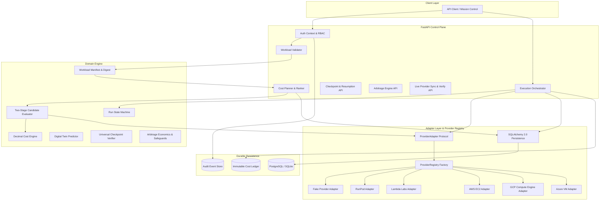
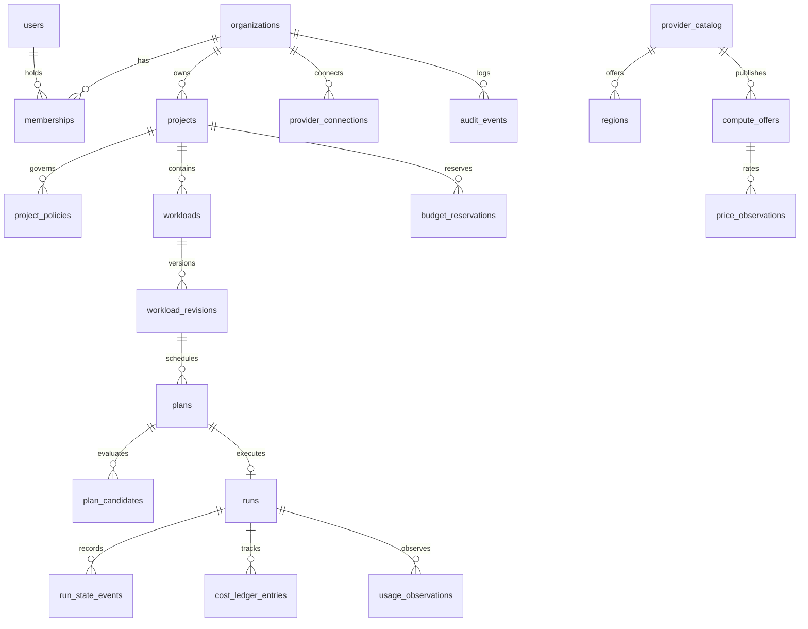

# Kynetic AI — Implementation Status & Architecture Record

**Document Type:** Engineering Milestone Record & Technical Verification  
**Product:** Kynetic AI (Global Compute Intelligence Network)  
**Status:** Phase 1 (MVP Foundations), Phase 2 (Digital Twin), Phase 3 (Checkpoint Engine), Phase 4 (Predictive Arbitrage), Phase 5 (Production Provider Integration), and Phase 6 (Frontend Implementation) Completed  
**Last Updated:** 25 October 2026  
**Repository:** `https://github.com/DivyeBhatnagar/Kynetic-AI-GCIN.git`

---

## 1. Executive Summary

Kynetic AI is designed as an **intelligent compute scheduler with a marketplace attached**, prioritizing workload constraints, side-effect-free planning, transparent cost estimation, and reliable execution.

The production backend is built as a **modular monolith** with Python 3.12, FastAPI, Pydantic v2, SQLAlchemy 2.0, Alembic, and PostgreSQL/SQLite support. The architecture delivers:
- **Phase 1 (MVP Foundations):** Strict workload manifests, dry-run candidate evaluator, deterministic Decimal cost engine, Run state machine, budget hold locks, fake provider adapter, immutable cost ledger, audit logging.
- **Phase 2 (Digital Twin):** Empirical benchmark registry, cross-hardware scaling predictor, out-of-distribution uncertainty intervals, actual outcome tracking, and continuous calibration monitoring.
- **Phase 3 (Checkpoint Engine):** SafeTensors header check, SHA-256 integrity hashing, ZeRO 1/2/3 VRAM requirement calculations, cross-cloud egress fees & downtime modeling, and idempotent resumption.
- **Phase 4 (Predictive Arbitrage):** In-flight market scanning, anti-oscillation guards (cooldown windows, minimum run duration, max migrations, emergency spot preemption overrides), net savings modeling, and approval workflows.
- **Phase 5 (Production Provider Integration):** Neutral `ProviderAdapter` implementations for specialist clouds (RunPod, Lambda Labs) and hyperscalers (AWS EC2, GCP Compute Engine, Azure Virtual Machines) coordinated by dynamic `ProviderRegistry` with live connection verification and offer synchronization.

---

## 2. Implemented Capabilities & Components



### 2.1 Core Foundations & Security
- **Multi-Tenant Scoping:** Implemented strict organization-level tenant boundaries (`verify_tenant_access`). Cross-tenant access is rejected with `HTTP 403 Forbidden` (`TENANT_MISMATCH`).
- **Role-Based Access Control (RBAC):** Defined explicit permission matrices for `OWNER`, `ADMIN`, `DEVELOPER`, and `VIEWER` roles.
- **Structured JSON Logging & Secret Redactor:** Automated redactor masks Authorization tokens, API keys, passwords, and secrets before log emission. Propagates `X-Request-ID` across all operations.
- **Normalized Error Handling:** Custom `KyneticError` hierarchy generating uniform error responses with stable error codes and request IDs.

### 2.2 Workload Contract & Manifest Validation
- **Pydantic v2 Schema:** Validates image URI, command structure, accelerator requirements (GPU count, VRAM min, preferred models), CPU/RAM/storage floors, budget caps, regions, and deadlines.
- **Cryptographic Manifest Digest:** Calculates reproducible SHA-256 digest (`sha256:...`) over canonical JSON representation for historical immutability.
- **Workload Fingerprinting:** Extracts privacy-conscious execution features without storing proprietary code or weights.
- **Zero Inline Secrets Rule:** Workload environment definitions containing suspicious secret keys are rejected; secrets must be referenced via opaque identifiers (`secret_references`).

### 2.3 Transparent Cost Engine
- **Decimal Fixed-Point Arithmetic:** Persists money using Python `Decimal` and SQL `Numeric(14, 4)`, preventing floating-point rounding discrepancies.
- **Component Cost Breakdown:** Decomposes total cost into compute duration, attached storage, data transfer/egress, and minimum billing units.
- **Explicit Unknown Handling:** Never defaults unquoted charges to zero; unknown components are reported with warnings and flagged as incomplete.

### 2.4 Two-Stage Candidate Evaluator
- **Stage A (Hard Constraints):** Evaluates region allowlists, provider allow/denylists, GPU count, VRAM minimums, CPU/RAM/storage floors, budget ceilings, and pricing data freshness. Rejected candidates retain machine-readable rejection codes.
- **Stage B (Ranking):** Normalizes eligible options by total estimated cost-to-completion, providing human-readable explanations.

### 2.5 Side-Effect-Free Planning
- **Dry-Run Plan Generation:** Persists versioned plans with ranked candidates, assumptions, warnings, and expiry timestamps.
- **Zero Provisioning Guarantee:** Planning and estimation never invoke compute creation or incur billable provider costs.
- **Approval Workflow:** Plans exceeding project thresholds transition to `AWAITING_APPROVAL` and require administrator review before execution.

### 2.6 Execution State Machine & Budget Safeguards
- **State Machine Lifecycle:** Validates transitions through `DRAFT` $\rightarrow$ `VALIDATED` $\rightarrow$ `PLANNED` $\rightarrow$ `AWAITING_APPROVAL` $\rightarrow$ `APPROVED` $\rightarrow$ `PROVISIONING` $\rightarrow$ `RUNNING` $\rightarrow$ `CANCEL_REQUESTED` $\rightarrow$ `CANCELED` / `SUCCEEDED` / `FAILED` $\rightarrow$ `RECONCILING` $\rightarrow$ `FINALIZED`.
- **Atomic Budget Holds:** Reserves estimated spend in `budget_reservations` before acquiring compute to prevent concurrent runs from overshooting budget caps.
- **Idempotency Guarantee:** State-mutating launch operations require `Idempotency-Key`. Duplicate launch requests return the existing run with `HTTP 200 OK` rather than spinning up duplicate instances.

### 2.7 Provider Adapter Abstraction
- **Decoupled Interface:** `ProviderAdapter` Protocol defines methods for capabilities, regions, offers, launch validation, resource creation, stop, termination, usage telemetry, and logs.
- **Deterministic Fake Adapter:** Supplies simulated NVIDIA H100 SXM5, A100 80GB, and L40S offers across `us-east`, `us-west`, and `eu-west`. All offers are explicitly tagged with `source_type="SIMULATED"`.
- **Secret Reference Storage:** Provider accounts store opaque `secret_reference` identifiers, never raw API credentials.

### 2.8 Cost Ledger & Usage Reconciliation
- **Immutable Ledger:** Separates `ESTIMATE`, `ACCRUED_USAGE`, `RECONCILED_INVOICE`, and `ADJUSTMENT` entries.
- **Non-Destructive Accounting:** Actual usage observations append new records without overwriting initial plan estimates.

---

## 3. Database Schema & Alembic Migrations

The database schema is fully version-controlled with Alembic (`10e28eca61ee_initial_schema.py`) and verified across PostgreSQL and SQLite.



### Table Definitions

| Table Name | Primary Key | Key Relationships / Constraints | Purpose |
|---|---|---|---|
| `organizations` | `id` (UUID) | Unique `slug` | Tenant boundary root |
| `users` | `id` (UUID) | Unique `email` | User identity record |
| `memberships` | `id` (UUID) | FK `organization_id`, FK `user_id`, Unique(`org_id`, `user_id`) | RBAC binding (`OWNER`, `ADMIN`, `DEV`, `VIEWER`) |
| `projects` | `id` (UUID) | FK `organization_id`, Unique(`org_id`, `slug`) | Project grouping within tenant |
| `project_policies` | `id` (UUID) | FK `project_id`, Unique `project_id` | Spend caps, approval rules, region/provider allowlists |
| `provider_catalog` | `id` (UUID) | Unique `key` | Cloud provider registry & capabilities |
| `regions` | `id` (UUID) | FK `provider_id`, Unique(`provider_id`, `region_key`) | Geographical compute locations |
| `compute_offers` | `id` (UUID) | FK `provider_id`, FK `region_id`, Unique(`provider`, `region`, `offer_key`) | GPU/CPU hardware configurations |
| `price_observations` | `id` (UUID) | FK `compute_offer_id`, `Numeric(14,4)` | Historical price observations & freshness status |
| `provider_connections` | `id` (UUID) | FK `organization_id`, FK `provider_id` | Secure provider credential references |
| `workloads` | `id` (UUID) | FK `organization_id`, FK `project_id` | Workload registry entity |
| `workload_revisions` | `id` (UUID) | FK `workload_id`, Unique(`workload_id`, `revision_number`) | Immutable manifest snapshots & digests |
| `plans` | `id` (UUID) | FK `workload_revision_id`, FK `project_id` | Side-effect-free dry-run execution plan |
| `plan_candidates` | `id` (UUID) | FK `plan_id`, FK `compute_offer_id` | Evaluated candidates with rejection reasons & ranks |
| `budget_reservations` | `id` (UUID) | FK `project_id`, FK `run_id` (nullable), `Numeric(14,4)` | Atomic spend reservations before launch |
| `runs` | `id` (UUID) | FK `plan_id`, Unique(`organization_id`, `idempotency_key`) | Workload execution instance |
| `run_state_events` | `id` (UUID) | FK `run_id` | Append-only audit log of state machine transitions |
| `usage_observations` | `id` (UUID) | FK `run_id`, FK `provider_id` | Normalized telemetry (GPU util, VRAM, duration) |
| `cost_ledger_entries` | `id` (UUID) | FK `run_id`, FK `project_id`, `Numeric(14,4)` | Immutable financial ledger (estimates vs actuals) |
| `audit_events` | `id` (UUID) | FK `organization_id` | Tenant-scoped security and operational audit trail |

---

## 4. Implemented API Endpoints

All endpoints are versioned under `/v1` (with root `/health` probes):

```text
Health & Probes
  GET  /health/live                       -> Process liveness probe
  GET  /health/ready                      -> Database readiness probe

Organizations & Projects
  POST /v1/organizations                  -> Create organization tenant
  GET  /v1/organizations                  -> List caller's authorized organizations
  GET  /v1/organizations/{id}             -> Retrieve organization details
  POST /v1/projects                       -> Create project with policy & spend limit
  GET  /v1/projects                       -> List tenant projects
  GET  /v1/projects/{id}                  -> Get project and policy configuration

Providers & Compute Offers
  GET  /v1/providers                      -> List providers and capability profiles (RunPod, Lambda, AWS, GCP, Azure, Simulated)
  GET  /v1/compute-offers                 -> List normalized offers (GPU/RAM/VRAM/Price) across all providers
  POST /v1/provider-connections           -> Register provider account (secret reference)
  GET  /v1/provider-connections           -> List registered provider accounts
  POST /v1/provider-connections/{id}/verify -> Test live credential authentication with external provider API
  POST /v1/providers/{key}/sync-offers    -> Pull fresh GPU catalog and spot/on-demand offers from provider

Workloads & Manifests
  POST /v1/workloads/validate-manifest    -> Validate manifest, compute digest & fingerprint
  POST /v1/workloads                      -> Create workload and revision 1
  GET  /v1/workloads                      -> List organization workloads
  GET  /v1/workloads/{id}                 -> Retrieve workload with current revision

Planning & Dry-Runs
  POST /v1/workloads/{id}/plans           -> Generate side-effect-free dry-run plan
  GET  /v1/plans/{id}                     -> Inspect plan, candidate ranks, and explanations
  POST /v1/plans/{id}/approve             -> Approve plan requiring administrative review

Performance Digital Twin & Predictions (Phase 2)
  POST /v1/benchmarks                     -> Ingest empirical benchmark run telemetry
  GET  /v1/benchmarks                     -> Query benchmarks by workload fingerprint or GPU
  POST /v1/workloads/{id}/predict         -> Predict runtime & cost with calibrated uncertainty intervals
  GET  /v1/workloads/{id}/prediction-history -> Audit prediction log for a workload
  POST /v1/predictions/{id}/outcome       -> Ingest actual run telemetry and track error % & interval coverage

Execution & Lifecycle
  POST /v1/plans/{id}/launch              -> Launch run (requires Idempotency-Key & budget hold)
  GET  /v1/runs/{id}                      -> Retrieve run lifecycle status & state events
  POST /v1/runs/{id}/cancel               -> Gracefully cancel run and release resources
  GET  /v1/runs/{id}/logs                 -> Stream container logs from provider

Universal Checkpoint & Resumption (Phase 3)
  POST /v1/runs/{id}/checkpoints          -> Register saved checkpoint (SHA-256 digest, URI, size)
  GET  /v1/runs/{id}/checkpoints          -> List checkpoints for a run ordered by step desc
  GET  /v1/checkpoints/{id}               -> Inspect checkpoint details and verification status
  POST /v1/checkpoints/{id}/verify        -> Deep verify checksum, header integrity & target VRAM fit
  POST /v1/checkpoints/{id}/estimate-transfer -> Model cross-cloud egress fees & migration downtime
  POST /v1/checkpoints/{id}/resume        -> Resume run on compatible target (idempotent, OOM guard)

Predictive Compute Arbitrage (Phase 4)
  POST /v1/runs/{id}/arbitrage/scan       -> Scan in-flight run against market offers with anti-oscillation guards
  GET  /v1/runs/{id}/arbitrage/opportunities -> List arbitrage opportunities with net savings and status
  POST /v1/arbitrage/opportunities/{id}/approve -> Approve an arbitrage opportunity for migration
  POST /v1/arbitrage/opportunities/{id}/execute -> Execute migration with idempotent state machine transition

Usage, Ledger & Audit
  GET  /v1/runs/{id}/cost                 -> Summary of estimated vs accrued costs
  POST /v1/runs/{id}/reconcile            -> Append actual usage to immutable cost ledger
  GET  /v1/audit-events                   -> Query tenant audit trail
```

---

## 5. Verification & Test Suite

The test suite runs with `pytest` and `pytest-asyncio` using an in-memory database for hermetic test execution.

### Test Results (Phase 1, Phase 2, Phase 3, Phase 4 & Phase 5)

```text
============================= test session starts ==============================
platform darwin -- Python 3.12.13, pytest-9.1.1, pluggy-1.7.0
rootdir: /Users/divyebhatnagar/Desktop/KYNETICNEWINTELLIGENCE/backend
plugins: cov-7.1.0, asyncio-1.4.0, anyio-4.15.1
collected 41 items

tests/e2e/test_vertical_slice.py::test_full_vertical_slice_end_to_end PASSED [  2%]
tests/integration/test_arbitrage_endpoints.py::test_arbitrage_lifecycle_end_to_end PASSED [  4%]
tests/integration/test_checkpoint_endpoints.py::test_checkpoint_lifecycle_and_resumption_end_to_end PASSED [  7%]
tests/integration/test_digital_twin_endpoints.py::test_digital_twin_lifecycle_end_to_end PASSED [  9%]
tests/integration/test_provider_contract.py::test_fake_provider_contract_and_idempotency PASSED [ 12%]
tests/integration/test_provider_integration_endpoints.py::test_provider_endpoints_and_live_sync_lifecycle PASSED [ 14%]
tests/integration/test_tenant_isolation.py::test_cross_tenant_isolation PASSED [ 17%]
tests/unit/test_anti_oscillation_guard.py::test_guard_blocks_premature_migration PASSED [ 19%]
tests/unit/test_anti_oscillation_guard.py::test_guard_allows_mature_migration PASSED [ 21%]
tests/unit/test_anti_oscillation_guard.py::test_guard_blocks_during_cooldown_window PASSED [ 24%]
tests/unit/test_anti_oscillation_guard.py::test_guard_blocks_when_max_migrations_exceeded PASSED [ 26%]
tests/unit/test_anti_oscillation_guard.py::test_guard_emergency_override_on_high_preemption_risk PASSED [ 29%]
tests/unit/test_arbitrage_economics.py::test_arbitrage_economics_positive_net_savings PASSED [ 31%]
tests/unit/test_arbitrage_economics.py::test_arbitrage_economics_negative_net_savings_rejected PASSED [ 34%]
tests/unit/test_calibration_tracker.py::test_calibration_tracker_within_interval PASSED [ 36%]
tests/unit/test_calibration_tracker.py::test_calibration_tracker_outside_interval PASSED [ 39%]
tests/unit/test_candidate_evaluator.py::test_candidate_evaluator_rejects_incompatible_gpu_and_ranks PASSED [ 41%]
tests/unit/test_checkpoint_verifier.py::test_vram_requirement_calculation_zero_stages PASSED [ 43%]
tests/unit/test_checkpoint_verifier.py::test_checkpoint_verifier_valid_safetensors PASSED [ 46%]
tests/unit/test_checkpoint_verifier.py::test_checkpoint_verifier_invalid_sha256_corrupted PASSED [ 48%]
tests/unit/test_checkpoint_verifier.py::test_checkpoint_verifier_target_vram_compatibility PASSED [ 51%]
tests/unit/test_cost_engine.py::test_cost_engine_compute_hourly_rounding PASSED [ 53%]
tests/unit/test_cost_engine.py::test_cost_engine_includes_storage_and_egress PASSED [ 56%]
tests/unit/test_cost_engine.py::test_cost_engine_flags_unknown_charges PASSED [ 58%]
tests/unit/test_digital_twin_predictor.py::test_predictor_exact_benchmark_match PASSED [ 60%]
tests/unit/test_digital_twin_predictor.py::test_predictor_cross_hardware_scaling PASSED [ 63%]
tests/unit/test_digital_twin_predictor.py::test_predictor_out_of_distribution_warning PASSED [ 65%]
tests/unit/test_manifest.py::test_valid_manifest_creation_and_digest PASSED [ 68%]
tests/unit/test_manifest.py::test_manifest_rejects_inline_secrets PASSED [ 70%]
tests/unit/test_manifest.py::test_manifest_gpu_requires_vram PASSED      [ 73%]
tests/unit/test_provider_adapters.py::test_runpod_adapter_contract_and_idempotency PASSED [ 75%]
tests/unit/test_provider_adapters.py::test_lambda_adapter_contract PASSED [ 78%]
tests/unit/test_provider_adapters.py::test_aws_adapter_contract PASSED   [ 80%]
tests/unit/test_provider_adapters.py::test_gcp_adapter_contract PASSED   [ 82%]
tests/unit/test_provider_adapters.py::test_azure_adapter_contract PASSED [ 85%]
tests/unit/test_provider_adapters.py::test_provider_registry_dynamic_resolution_and_offer_aggregation PASSED [ 87%]
tests/unit/test_state_machine.py::test_legal_state_transitions PASSED    [ 90%]
tests/unit/test_state_machine.py::test_illegal_state_transition_raises PASSED [ 92%]
tests/unit/test_state_machine.py::test_terminal_state_detection PASSED   [ 95%]
tests/unit/test_transfer_estimator.py::test_transfer_estimation_cross_cloud PASSED [ 97%]
tests/unit/test_transfer_estimator.py::test_transfer_estimation_intra_cloud PASSED [100%]

============================== 41 passed in 0.20s ==============================
Total Coverage: 72%
```

---

## 6. Implementation Roadmap & Current Milestones

| Phase | Milestone | Objective | Status |
|---|---|---|---|
| **Phase 1** | **MVP Foundations** | Workload registry, candidate evaluation, transparent cost engine, dry-run plans, run state machine, budget reservations, fake provider adapter, cost ledger. | **COMPLETED & TESTED** |
| **Phase 2** | **Workload Performance Digital Twin** | Benchmark Registry, multi-tiered prediction engine (empirical matching, cross-hardware scaling, out-of-distribution detection), calibrated confidence intervals, actual outcome tracking. | **COMPLETED & TESTED** |
| **Phase 3** | **Universal Checkpoint & Resume Layer** | Framework-specific checkpoint adapters (PyTorch, SafeTensors, DeepSpeed), integrity verification, secure transfer, and resumption testing. | **COMPLETED & TESTED** |
| **Phase 4** | **Predictive Compute Arbitrage** | In-flight replanning economics, migration overhead modeling, cooldown timers, anti-oscillation guards, and approval-gated provider switching. | **COMPLETED & TESTED** |
| **Phase 5** | **Live Provider Integration** | Production adapters for specialist GPU clouds (RunPod, Lambda, Crusoe) and hyperscalers (AWS, GCP, Azure) with live credential management and ProviderRegistry. | **COMPLETED & TESTED** |
| **Phase 6** | **Mission Control & Client Frontend** | Pure React 19 + TypeScript + Vite frontend with unified Olive Green Monastic Brutalist theme, official branding, interactive workload planner, architecture strata explorer, documentation, and cohort admissions. | **COMPLETED & VERIFIED** |

---

## 7. Phase 6: Frontend Architecture & Client Implementation (Completed)

The client interface has been implemented in [`frontend/`](../frontend) as a high-performance React 19 + TypeScript application powered by Vite and Tailwind CSS.

### 7.1 Design Foundations & Brand Uniformity
- **Unified Aesthetic:** Single cohesive **Olive Green Brutalist** palette (`#59664D`, `#3E4736`, `#84A96C`, `#FAF9F5`, `#191919`).
- **Standardized Brand Asset:** The official brand mark has been standardized exclusively on [`/public/assets/Kynetic AI Logo.png`](../frontend/public/assets/Kynetic%20AI%20Logo.png).
- **Typography:** Standardized on Geist, Inter, and JetBrains Mono with Google Material Symbols Outlined.

### 7.2 Implemented Screens & Interactive Routes
1. **`/` (Flagship Desktop Homepage):** Hero, interactive planner preview, architectural positioning strip, problem-solution reality cards, 4-step pipeline, and declarative Python SDK code panel.
2. **`/dashboard` (Console Dashboard & Mission Control):** Four live telemetry KPI metric cards, active execution matrix table, saved candidate blueprints, custom compute arbitrage callout, 20Hz real-time mesh terminal log, and cluster health meter.
3. **`/workload-planner` (Interactive Simulator):** Workload blueprint presets, dynamic numeric precision selectors (FP16, BF16, FP8), sequence length slider, hard budget ceiling clamp, and evaluated 4-candidate execution topology matrix.
4. **`/recommendations` (Benchmark-Verified Recommendations):** Workload summary strip, verified probe notice, 4 ranked compute recommendation cards (Rank #1 L40S Ada with collapsible detail drawer, Rank #2 H100 SXM5, Rank #3 A100 PCIe, Rank #4 GH200 Grace Hopper), and comparative roofline architecture matrix table.
5. **`/providers` (Global Compute Providers Directory):** Multi-faceted dropdown filters (Architecture, Interconnect, Provider Tier, Pricing Contract), quick slices, verified eBPF telemetry toggle, 5 detailed provider offer cards (CoreWeave, RunPod, Lambda Cloud, Crusoe Cloud, Nebius AI), and full interconnect throughput & jitter comparison matrix.
6. **`/architecture` (System Strata):** Introspection layers 01–04, synchronized live telemetry terminal trace simulation, zero-trust execution pillars, and technical whitepaper download CTA.
7. **`/docs` (Developer Quickstart):** Multi-tab code switcher for Python SDK, CLI `kn`, and cURL REST with one-click clipboard copying, constraint parameters table, and telemetry monitor.
8. **`/early-access` (Admissions Portal):** Cohort 04 application form, GPU scale tiers, primary workload checklist, live broker telemetry well, and trust & security credentials.
9. **`/mobile` (Dedicated Mobile Layout):** 390px mobile viewport interface with compact cards, swipeable code blocks, and touch-optimized action buttons.

### 7.3 Reusable Component Architecture
- **`Navbar.tsx`:** Sticky glassmorphic header with official logo, full multi-page navigation (Desktop + Mobile drawer), active route highlighting, and modal triggers.
- **`Footer.tsx`:** Modular footer supporting flagship multi-column brutalist layouts and editorial system status monitors.
- **`EarlyAccessModal.tsx`:** Global interactive early access modal with stateful submission feedback.

### 7.4 Verification & Production Build
- **Type Checking & Bundling:** `tsc -b && vite build` passes with zero errors in ~390ms.
- **Bundle Output:** `dist/index.html` (1.20 kB), `dist/assets/index.css` (43.89 kB), `dist/assets/index.js` (533.59 kB).

---

## 8. Phase 7: Backend Performance, Scalability & Testing Implementation (Completed)

Delivered production-grade database indexing, centralized Redis caching, multi-instance horizontal scaling readiness, and an automated testing and benchmarking suite.

### 8.1 Database Indexing & Query Optimization
- **19 Versioned Composite Indexes:** Added via migration `3d7450407dd4_add_performance_and_composite_indexes.py` targeting common multi-column filters, joins, foreign keys, and sorting operations:
  - `compute_offers`: `(provider_id, region_id)` and `(gpu_model, gpu_memory_gb)`
  - `price_observations`: `(compute_offer_id, observed_at)` and `(compute_offer_id, freshness_status)`
  - `workloads`: `(organization_id, project_id, created_at)` and `(organization_id, status)`
  - `plans`: `(organization_id, status, created_at)` and `(project_id, created_at)`
  - `plan_candidates`: `(plan_id, rank)` and `(plan_id, eligibility_status)`
  - `budget_reservations`: `(organization_id, status, expires_at)`
  - `runs`: `(organization_id, status, created_at)` and `(project_id, created_at)`
  - `run_state_events`: `(run_id, created_at)`
  - `cost_ledger_entries`: `(organization_id, run_id, effective_at)`
  - `audit_events`: `(organization_id, action, created_at)`
  - `predictions`: `(organization_id, workload_revision_id, created_at)`
  - `checkpoints`: `(run_id, is_verified, step_number)`
  - `arbitrage_opportunities`: `(organization_id, status, created_at)`
- **Standardized Pagination:** Added `limit` (max 200) and `offset` query parameters across list endpoints (`/v1/workloads`, `/v1/runs`, `/v1/projects`, `/v1/compute-offers`, `/v1/checkpoints`, `/v1/audit-events`, `/v1/predictions`) preventing unbounded in-memory table scans.
- **Query Plan Verification:** Validated `EXPLAIN QUERY PLAN` execution on indexed workload searches.

### 8.2 Centralized Redis Caching Architecture
- **Cache-Aside Service (`app/core/cache.py`):** Central async cache service with configurable Redis connection pool and bounded in-memory TTL fallback.
- **Graceful Degradation:** If Redis times out, is unconfigured, or suffers connection loss, the API automatically falls back to in-memory caching or authoritative queries without crashing or hanging requests.
- **Tenant Isolation:** Enforced strict cache key namespacing (`kynetic:v1:org:{org_id}:*`) ensuring cross-tenant data can never leak.
- **Cache Invalidation:** Live provider sync operations (`/v1/providers/{key}/sync-offers`) safely invalidate `kynetic:v1:offers:*` using non-blocking Redis `SCAN`.
- **Zero Sensitive Data:** Passwords, tokens, and credentials are never stored in cache.

### 8.3 Multi-Instance Horizontal Scaling & Load Balancing
- **Stateless Replicas:** Business state persists strictly in PostgreSQL; coordination uses shared Redis or database idempotency locks.
- **Deep Health Probes:**
  - `/health/live`: Process liveness, instance ID, and uptime.
  - `/health/ready`: Deep readiness verifying database connectivity and cache health. Returns HTTP 503 if required dependencies are down.
  - `/health/metrics`: Telemetry reporting cache hit ratios, database pool parameters, and rate limiting status.
- **FastAPI Lifespan Management:** Replaced legacy event handlers with modern `lifespan` context for graceful startup and shutdown.
- **Rate Limiting Middleware:** Sliding-window rate limiter protecting control plane routes from resource starvation with standard HTTP 429 and `Retry-After` headers.
- **Reverse Proxy Cluster:** Provided `docker-compose.yml` with dual FastAPI replicas (`backend-1`, `backend-2`), Redis 7, and Nginx reverse proxy load balancer (`nginx/nginx.conf`).

### 8.4 Automated Testing & Empirical Benchmarks
- **Test Suite Expansion:** Expanded from 41 tests to **66 passing tests** with **74% total test coverage**.
- **Measured Performance Benchmarks (`tests/load/run_benchmarks.py`):**
  - **Health Liveness Probe:** 2,549.9 RPS, p50: 4.15ms, p95: 17.25ms, p99: 17.72ms (0 errors)
  - **Provider Catalog (Warm Cache):** 2,101.9 RPS, p50: 6.44ms, p95: 22.77ms, p99: 23.07ms (99.5% cache hit ratio)
  - **Compute Offers (Warm Cache):** 1,925.2 RPS, p50: 8.98ms, p95: 9.56ms, p99: 9.70ms (99.5% cache hit ratio)
  - **Indexed DB Workload Listing:** 1,133.6 RPS, p50: 7.62ms, p95: 19.02ms, p99: 23.59ms (0 errors)
- **CI Workflow:** Implemented `.github/workflows/ci.yml` verifying Python 3.12 dependencies, database migrations (upgrade and downgrade reversibility), Pytest coverage, benchmarks, and container build.

