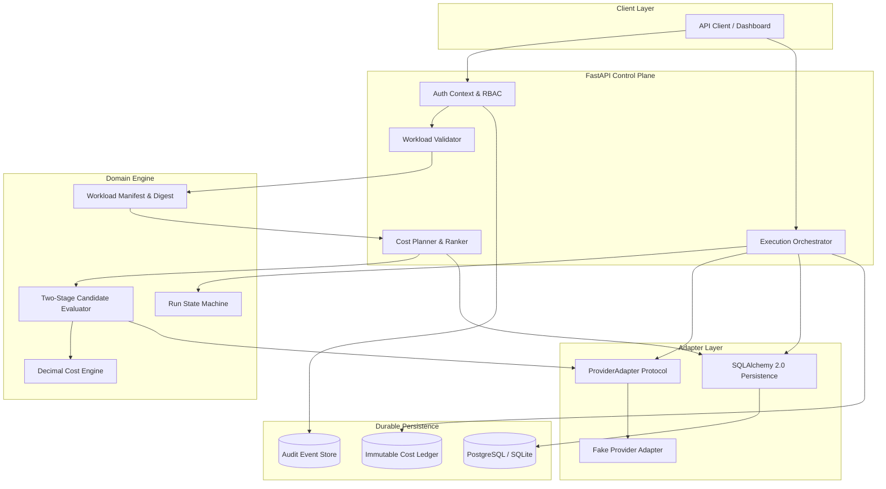
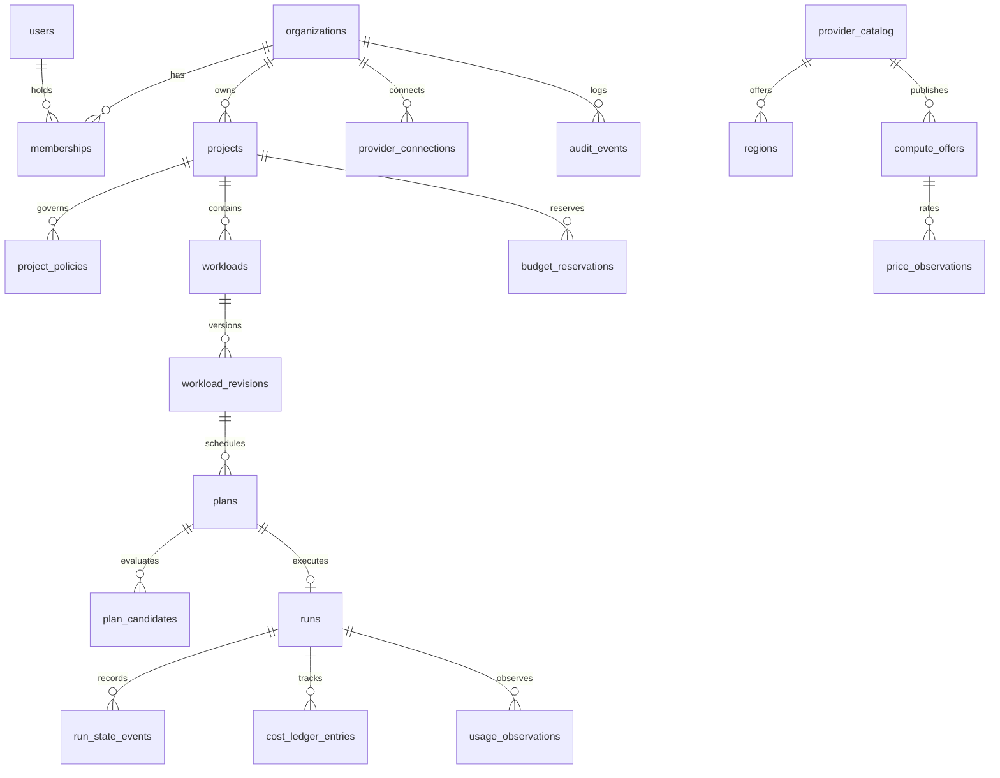

# Kynetic AI — Implementation Status & Architecture Record

**Document Type:** Engineering Milestone Record & Technical Verification  
**Product:** Kynetic AI (Global Compute Intelligence Network)  
**Status:** Phase 1 Backend Foundation & Vertical Slice Completed  
**Last Updated:** 25 October 2026  
**Repository:** `https://github.com/DivyeBhatnagar/Kynetic-AI-GCIN.git`

---

## 1. Executive Summary

Kynetic AI is designed as an **intelligent compute scheduler with a marketplace attached**, prioritizing workload constraints, side-effect-free planning, transparent cost estimation, and reliable execution.

Phase 1 establishes the production backend foundation as a **modular monolith** with Python 3.12, FastAPI, Pydantic v2, SQLAlchemy 2.0, Alembic, and PostgreSQL/SQLite support. The complete vertical slice—from workload manifest submission and dry-run candidate evaluation to atomic budget reservation, idempotent execution, and cost ledger reconciliation—is implemented and verified with automated tests.

---

## 2. Implemented Capabilities & Components



### 2.1 Core Foundations & Security
- **Multi-Tenant Scoping:** Implemented strict organization-level tenant boundaries (`verify_tenant_access`). Cross-tenant access is rejected with `HTTP 403 Forbidden` (`TENANT_MISMATCH`).
- **Role-Based Access Control (RBAC):** Defined explicit permission matrices for `OWNER`, `ADMIN`, `DEVELOPER`, and `VIEWER` roles.
- **Structured JSON Logging & Secret Redactor:** Automated redactor masks Authorization tokens, API keys, passwords, and secrets before log emission. Propagates `X-Request-ID` across all operations.
- **Normalized Error Handling:** Custom `KyneticError` hierarchy generating uniform error responses with stable error codes and request IDs.

### 2.2 Workload Contract & Manifest Validation
- **Pydantic v2 Schema:** Validates image URI, command structure, accelerator requirements (GPU count, VRAM min, preferred models), CPU/RAM/storage floors, budget caps, regions, and deadlines.
- **Cryptographic Manifest Digest:** Calculates reproducible SHA-256 digest (`sha256:...`) over canonical JSON representation for historical immutability.
- **Workload Fingerprinting:** Extracts privacy-conscious execution features without storing proprietary code or weights.
- **Zero Inline Secrets Rule:** Workload environment definitions containing suspicious secret keys are rejected; secrets must be referenced via opaque identifiers (`secret_references`).

### 2.3 Transparent Cost Engine
- **Decimal Fixed-Point Arithmetic:** Persists money using Python `Decimal` and SQL `Numeric(14, 4)`, preventing floating-point rounding discrepancies.
- **Component Cost Breakdown:** Decomposes total cost into compute duration, attached storage, data transfer/egress, and minimum billing units.
- **Explicit Unknown Handling:** Never defaults unquoted charges to zero; unknown components are reported with warnings and flagged as incomplete.

### 2.4 Two-Stage Candidate Evaluator
- **Stage A (Hard Constraints):** Evaluates region allowlists, provider allow/denylists, GPU count, VRAM minimums, CPU/RAM/storage floors, budget ceilings, and pricing data freshness. Rejected candidates retain machine-readable rejection codes.
- **Stage B (Ranking):** Normalizes eligible options by total estimated cost-to-completion, providing human-readable explanations.

### 2.5 Side-Effect-Free Planning
- **Dry-Run Plan Generation:** Persists versioned plans with ranked candidates, assumptions, warnings, and expiry timestamps.
- **Zero Provisioning Guarantee:** Planning and estimation never invoke compute creation or incur billable provider costs.
- **Approval Workflow:** Plans exceeding project thresholds transition to `AWAITING_APPROVAL` and require administrator review before execution.

### 2.6 Execution State Machine & Budget Safeguards
- **State Machine Lifecycle:** Validates transitions through `DRAFT` $\rightarrow$ `VALIDATED` $\rightarrow$ `PLANNED` $\rightarrow$ `AWAITING_APPROVAL` $\rightarrow$ `APPROVED` $\rightarrow$ `PROVISIONING` $\rightarrow$ `RUNNING` $\rightarrow$ `CANCEL_REQUESTED` $\rightarrow$ `CANCELED` / `SUCCEEDED` / `FAILED` $\rightarrow$ `RECONCILING` $\rightarrow$ `FINALIZED`.
- **Atomic Budget Holds:** Reserves estimated spend in `budget_reservations` before acquiring compute to prevent concurrent runs from overshooting budget caps.
- **Idempotency Guarantee:** State-mutating launch operations require `Idempotency-Key`. Duplicate launch requests return the existing run with `HTTP 200 OK` rather than spinning up duplicate instances.

### 2.7 Provider Adapter Abstraction
- **Decoupled Interface:** `ProviderAdapter` Protocol defines methods for capabilities, regions, offers, launch validation, resource creation, stop, termination, usage telemetry, and logs.
- **Deterministic Fake Adapter:** Supplies simulated NVIDIA H100 SXM5, A100 80GB, and L40S offers across `us-east`, `us-west`, and `eu-west`. All offers are explicitly tagged with `source_type="SIMULATED"`.
- **Secret Reference Storage:** Provider accounts store opaque `secret_reference` identifiers, never raw API credentials.

### 2.8 Cost Ledger & Usage Reconciliation
- **Immutable Ledger:** Separates `ESTIMATE`, `ACCRUED_USAGE`, `RECONCILED_INVOICE`, and `ADJUSTMENT` entries.
- **Non-Destructive Accounting:** Actual usage observations append new records without overwriting initial plan estimates.

---

## 3. Database Schema & Alembic Migrations

The database schema is fully version-controlled with Alembic (`10e28eca61ee_initial_schema.py`) and verified across PostgreSQL and SQLite.



### Table Definitions

| Table Name | Primary Key | Key Relationships / Constraints | Purpose |
|---|---|---|---|
| `organizations` | `id` (UUID) | Unique `slug` | Tenant boundary root |
| `users` | `id` (UUID) | Unique `email` | User identity record |
| `memberships` | `id` (UUID) | FK `organization_id`, FK `user_id`, Unique(`org_id`, `user_id`) | RBAC binding (`OWNER`, `ADMIN`, `DEV`, `VIEWER`) |
| `projects` | `id` (UUID) | FK `organization_id`, Unique(`org_id`, `slug`) | Project grouping within tenant |
| `project_policies` | `id` (UUID) | FK `project_id`, Unique `project_id` | Spend caps, approval rules, region/provider allowlists |
| `provider_catalog` | `id` (UUID) | Unique `key` | Cloud provider registry & capabilities |
| `regions` | `id` (UUID) | FK `provider_id`, Unique(`provider_id`, `region_key`) | Geographical compute locations |
| `compute_offers` | `id` (UUID) | FK `provider_id`, FK `region_id`, Unique(`provider`, `region`, `offer_key`) | GPU/CPU hardware configurations |
| `price_observations` | `id` (UUID) | FK `compute_offer_id`, `Numeric(14,4)` | Historical price observations & freshness status |
| `provider_connections` | `id` (UUID) | FK `organization_id`, FK `provider_id` | Secure provider credential references |
| `workloads` | `id` (UUID) | FK `organization_id`, FK `project_id` | Workload registry entity |
| `workload_revisions` | `id` (UUID) | FK `workload_id`, Unique(`workload_id`, `revision_number`) | Immutable manifest snapshots & digests |
| `plans` | `id` (UUID) | FK `workload_revision_id`, FK `project_id` | Side-effect-free dry-run execution plan |
| `plan_candidates` | `id` (UUID) | FK `plan_id`, FK `compute_offer_id` | Evaluated candidates with rejection reasons & ranks |
| `budget_reservations` | `id` (UUID) | FK `project_id`, FK `run_id` (nullable), `Numeric(14,4)` | Atomic spend reservations before launch |
| `runs` | `id` (UUID) | FK `plan_id`, Unique(`organization_id`, `idempotency_key`) | Workload execution instance |
| `run_state_events` | `id` (UUID) | FK `run_id` | Append-only audit log of state machine transitions |
| `usage_observations` | `id` (UUID) | FK `run_id`, FK `provider_id` | Normalized telemetry (GPU util, VRAM, duration) |
| `cost_ledger_entries` | `id` (UUID) | FK `run_id`, FK `project_id`, `Numeric(14,4)` | Immutable financial ledger (estimates vs actuals) |
| `audit_events` | `id` (UUID) | FK `organization_id` | Tenant-scoped security and operational audit trail |

---

## 4. Implemented API Endpoints

All endpoints are versioned under `/v1` (with root `/health` probes):

```text
Health & Probes
  GET  /health/live                       -> Process liveness probe
  GET  /health/ready                      -> Database readiness probe

Organizations & Projects
  POST /v1/organizations                  -> Create organization tenant
  GET  /v1/organizations                  -> List caller's authorized organizations
  GET  /v1/organizations/{id}             -> Retrieve organization details
  POST /v1/projects                       -> Create project with policy & spend limit
  GET  /v1/projects                       -> List tenant projects
  GET  /v1/projects/{id}                  -> Get project and policy configuration

Providers & Compute Offers
  GET  /v1/providers                      -> List providers and capability profiles
  GET  /v1/compute-offers                 -> List normalized offers (GPU/RAM/VRAM/Price)
  POST /v1/provider-connections           -> Register provider account (secret reference)
  GET  /v1/provider-connections           -> List registered provider accounts

Workloads & Manifests
  POST /v1/workloads/validate-manifest    -> Validate manifest, compute digest & fingerprint
  POST /v1/workloads                      -> Create workload and revision 1
  GET  /v1/workloads                      -> List organization workloads
  GET  /v1/workloads/{id}                 -> Retrieve workload with current revision

Planning & Dry-Runs
  POST /v1/workloads/{id}/plans           -> Generate side-effect-free dry-run plan
  GET  /v1/plans/{id}                     -> Inspect plan, candidate ranks, and explanations
  POST /v1/plans/{id}/approve             -> Approve plan requiring administrative review

Execution & Lifecycle
  POST /v1/plans/{id}/launch              -> Launch run (requires Idempotency-Key & budget hold)
  GET  /v1/runs/{id}                      -> Retrieve run lifecycle status & state events
  POST /v1/runs/{id}/cancel               -> Gracefully cancel run and release resources
  GET  /v1/runs/{id}/logs                 -> Stream container logs from provider

Usage, Ledger & Audit
  GET  /v1/runs/{id}/cost                 -> Summary of estimated vs accrued costs
  POST /v1/runs/{id}/reconcile            -> Append actual usage to immutable cost ledger
  GET  /v1/audit-events                   -> Query tenant audit trail
```

---

## 5. Verification & Test Suite

The test suite runs with `pytest` and `pytest-asyncio` using an in-memory database for hermetic test execution.

### Test Results

```text
============================= test session starts ==============================
platform darwin -- Python 3.12.13, pytest-9.1.1, pluggy-1.7.0
rootdir: /Users/divyebhatnagar/Desktop/KYNETICNEWINTELLIGENCE/backend
collected 13 items

tests/e2e/test_vertical_slice.py::test_full_vertical_slice_end_to_end PASSED   [  7%]
tests/integration/test_provider_contract.py::test_fake_provider_contract_and_idempotency PASSED [ 15%]
tests/integration/test_tenant_isolation.py::test_cross_tenant_isolation PASSED [ 23%]
tests/unit/test_candidate_evaluator.py::test_candidate_evaluator_rejects_incompatible_gpu_and_ranks PASSED [ 30%]
tests/unit/test_cost_engine.py::test_cost_engine_compute_hourly_rounding PASSED [ 38%]
tests/unit/test_cost_engine.py::test_cost_engine_includes_storage_and_egress PASSED [ 46%]
tests/unit/test_cost_engine.py::test_cost_engine_flags_unknown_charges PASSED  [ 53%]
tests/unit/test_manifest.py::test_valid_manifest_creation_and_digest PASSED    [ 61%]
tests/unit/test_manifest.py::test_manifest_rejects_inline_secrets PASSED        [ 69%]
tests/unit/test_manifest.py::test_manifest_gpu_requires_vram PASSED             [ 76%]
tests/unit/test_state_machine.py::test_legal_state_transitions PASSED           [ 84%]
tests/unit/test_state_machine.py::test_illegal_state_transition_raises PASSED   [ 92%]
tests/unit/test_state_machine.py::test_terminal_state_detection PASSED          [100%]

============================== 13 passed in 0.25s ==============================
Total Coverage: 76%
```

---

## 6. Future Phases & Roadmap

| Phase | Milestone | Objective |
|---|---|---|
| **Phase 1 (Completed)** | **MVP Foundations** | Workload registry, candidate evaluation, transparent cost engine, dry-run plans, run state machine, budget reservations, fake provider adapter, cost ledger. |
| **Phase 2 (Next)** | **Workload Performance Digital Twin** | Benchmark data ingestion, workload fingerprint matching, runtime/cost predictive models with calibrated confidence intervals. |
| **Phase 3** | **Universal Checkpoint & Resume Layer** | Framework-specific checkpoint adapters (PyTorch, DeepSpeed), integrity verification, secure transfer, and resumption testing. |
| **Phase 4** | **Predictive Compute Arbitrage** | In-flight replanning economics, migration overhead modeling, cooldown timers, anti-oscillation guards, and approval-gated provider switching. |
| **Phase 5** | **Live Provider Integration** | Production adapters for specialist GPU clouds (RunPod, Lambda, Crusoe) and hyperscalers (AWS, GCP) once credentials and terms are finalized. |
