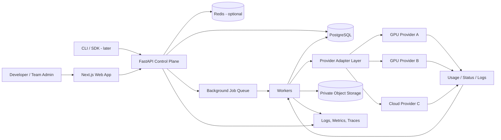
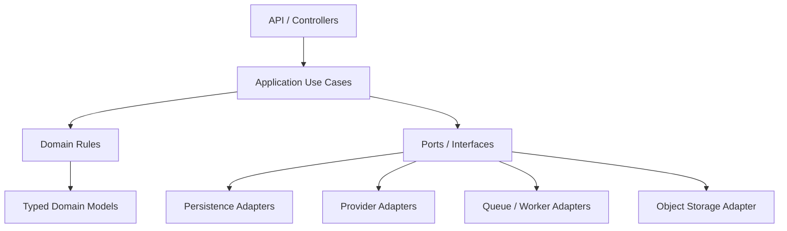
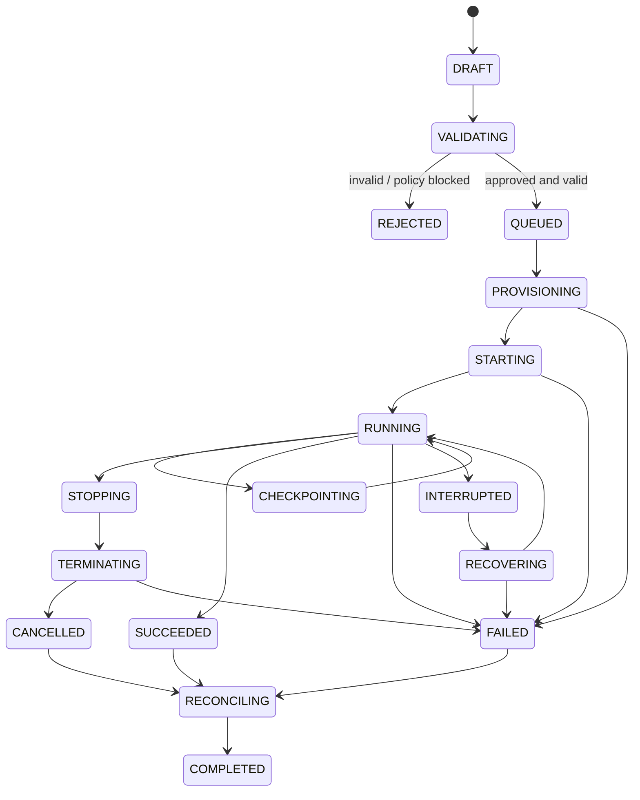
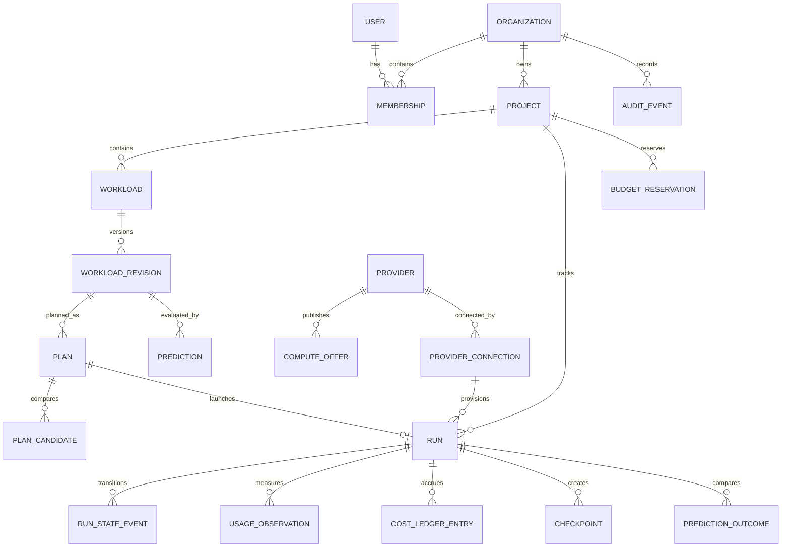
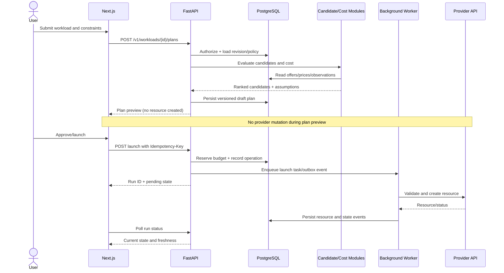
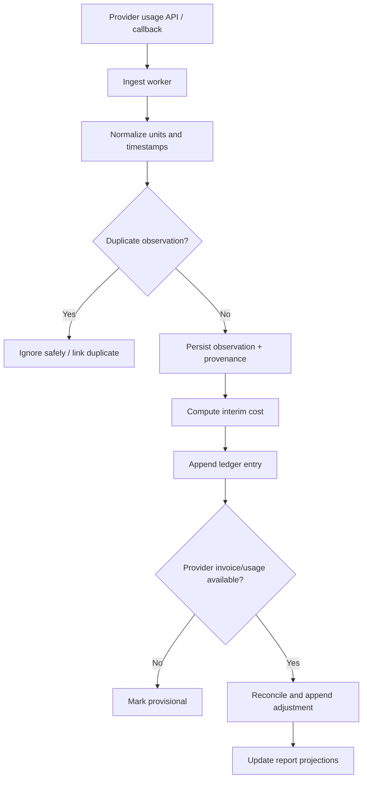
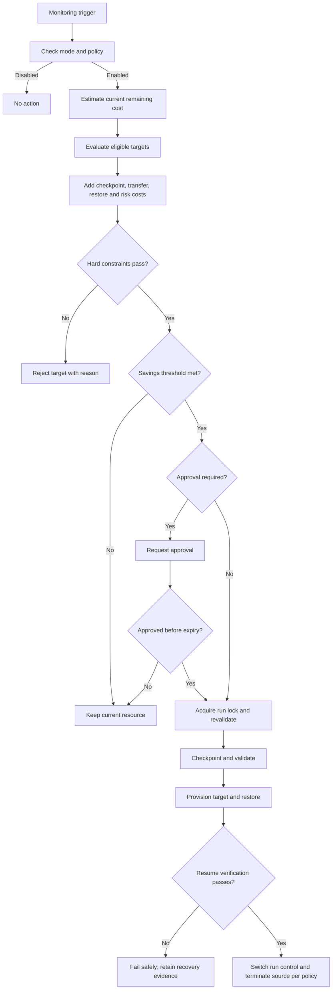

# Kynetic AI — Complete System Architecture
**Document type:** System Architecture & Engineering Blueprint  
**Product:** Kynetic AI  
**Version:** 1.0  
**Status:** Proposed reference architecture; implementation must be staged  
**Audience:** Founders, frontend/backend engineers, infrastructure engineers, AI/ML engineers, security reviewers, and coding agents  
**Last updated:** 25 October 2026

> **Architecture principle:** Build Kynetic AI as an intelligent compute scheduler with a marketplace attached—not as a marketplace that later tries to add intelligence.

---

## 0. How to Use This Document

This document describes the intended end-state architecture and a safe implementation path. It is not an instruction to build every subsystem immediately.

- **MUST** indicates a requirement for correctness, safety, security, or data integrity.
- **SHOULD** indicates a strong default that can be changed with a documented reason.
- **MAY** indicates an optional capability.
- **Phase 1** means the bootstrap-friendly MVP: manifests, provider/candidate abstraction, cost estimates, dry-run plans, controlled execution records, actual usage/cost capture, audit logs, and basic policy checks.
- **Later phases** add measured performance prediction, automated re-planning, checkpoint/resume adapters, and larger-scale provider orchestration.
- Any provider, feature, price, hardware capability, or benchmark not verified by an integration test or trustworthy source MUST be marked as unknown, stale, estimated, or simulated. Never make demo data look like live provider data.

The exact provider set, production cloud, pricing source, model framework coverage, and compliance obligations are decisions to validate during implementation. The architecture intentionally separates these decisions from core domain logic.

## 1. Executive Summary

Kynetic AI is a software-first compute intelligence and workload orchestration platform. It helps a developer or organization describe a workload, express constraints such as budget, deadline, region, reliability, and security, compare compatible compute options, create an execution plan, run supported workloads through provider adapters, track actual usage, and improve future recommendations from observed outcomes.

### 1.1 Core capabilities

1. **Workload contract:** A validated, versioned description of what needs to run and its constraints.
2. **Provider integration layer:** A common interface over different GPU/cloud providers without pretending that every provider supports identical capabilities.
3. **Cost-to-completion planner:** Compares total expected job cost—not only hourly GPU rates.
4. **Workload Performance Digital Twin:** Predicts runtime, throughput, compatibility, and cost ranges with uncertainty once sufficient benchmark data exists.
5. **Policy-aware scheduler:** Filters hard constraints first, then ranks viable options using cost, time, reliability, and user preference.
6. **Predictive Compute Arbitrage:** Re-evaluates a running job at safe boundaries and proposes or performs an approved move only when expected remaining savings justify migration risk and cost.
7. **Checkpoint/resume abstraction:** Supports framework-specific checkpoint adapters and validates a checkpoint before attempting restore.
8. **Execution and cost ledger:** Stores plan versions, state transitions, usage samples, estimated and reconciled costs, approvals, and audit records.
9. **Feedback loop:** Compares predicted versus actual runtime/cost and uses approved, privacy-conscious observations to improve future predictions.
10. **Developer experience:** Web dashboard, REST API, and later a CLI/SDK.

### 1.2 Non-goals for the initial release

- Owning data centers or purchasing GPU inventory.
- Guaranteeing that every workload can migrate live between providers.
- Migrating arbitrary GPU memory or unsupported distributed training across clouds.
- Fully autonomous, unbounded spending or provider procurement.
- Treating unverified provider pricing/availability as live.
- Building a microservice for every domain object before there is operational need.
- Promising a runtime or final cost with certainty when the estimate is inherently uncertain.

### 1.3 Recommended baseline

| Layer | Starting choice | Rationale |
|---|---|---|
| Web app | Next.js, React, TypeScript | Strong dashboard, forms, server/client composition |
| UI styling | Tailwind CSS and accessible component primitives | Consistent product UI and fast iteration |
| API/backend | Python, FastAPI, Pydantic | Typed API contracts, strong ML/integration ecosystem |
| Application structure | Modular monolith | Lower operational burden, explicit domain boundaries |
| Transactional database | PostgreSQL | Durable relational state and constraints |
| Database migrations | Alembic | Versioned, reviewable schema evolution |
| ORM/data access | SQLAlchemy 2.x or a consistent repository layer | Transactions and typed persistence |
| Async jobs | Initially a DB-backed job runner or Celery + Redis when needed | Keep long-running provider calls off request threads |
| Cache/coordination | Redis when required | Short-lived cache, rate limiting, worker coordination |
| Object storage | S3-compatible private bucket | Checkpoints, logs/artifacts, benchmark files |
| Workload packaging | OCI/Docker images | Repeatable environments |
| Observability | OpenTelemetry + structured logs + metrics | Trace request-to-provider workflow |
| Testing | pytest, API contract tests, integration tests; frontend unit/e2e tests | Regression and safety coverage |
| Deployment | Managed application runtime first; containers for workers | Bootstrap-friendly, with a migration path to Kubernetes |

Versions SHOULD be pinned and upgraded deliberately. The architecture does not depend on any single hosting vendor.

---

## 2. System Context and Trust Boundaries

### 2.1 Actors

- **Developer / ML engineer:** Defines workloads, submits plans, launches jobs, inspects logs and costs.
- **Team or organization admin:** Manages members, roles, provider credentials, policies, budgets, and audit access.
- **Kynetic operator:** Maintains provider adapters, verified pricing sources, integration health, and platform operations.
- **Provider API:** Provisions compute, returns instance status and usage/price information, and terminates resources.
- **Workload runtime:** The container/process executing customer code on provider infrastructure.
- **Object storage:** Stores approved checkpoint and artifact objects.
- **Background worker:** Performs pricing refreshes, prediction, provider operations, usage reconciliation, checkpoint work, and cleanup.

### 2.2 Trust boundaries

1. **Browser → Kynetic API:** Treat all input as untrusted; authenticate, authorize, validate, and rate-limit.
2. **Kynetic backend → provider APIs:** Use least-privilege credentials, explicit timeouts, idempotency where supported, and audit every mutation.
3. **Provider runtime → Kynetic control plane:** Runtime agents or callbacks are untrusted until authenticated; do not expose the internal control plane publicly.
4. **Customer container → host/provider environment:** Workloads are potentially malicious. Do not mount platform secrets or privileged host paths into user containers.
5. **Tenant A → Tenant B:** Enforce organization-scoped authorization in every query and object access path.
6. **Control plane → checkpoint/object storage:** Use private buckets, short-lived scoped credentials, encryption, and explicit retention/deletion policies.
7. **AI/ML prediction → execution decision:** Predictions are advisory inputs; hard policy constraints and deterministic safety checks remain authoritative.

### 2.3 Context diagram



This is a logical diagram, not a requirement to deploy every box separately. During the MVP, the API and domain modules can share one deployable application while workers run as a separate process.

---

## 3. Architecture Principles

1. **Modular monolith first:** Use explicit modules and dependency direction. Extract services only when there is a measured reason.
2. **Provider neutrality without false equivalence:** Normalize common concepts, preserve provider-specific capability differences.
3. **Plan before mutation:** Candidate discovery, estimate, and plan preview are non-billable. Provisioning requires authorization and a deliberate action.
4. **Hard constraints before scoring:** Region, data residency, budget ceiling, required hardware, security, and workload compatibility cannot be overridden by a weighted score.
5. **Total cost-to-completion:** Include startup, compute, storage, egress, checkpoint, restore, retry, idle time, and failure risk where data exists.
6. **Predictions include uncertainty:** Return ranges, assumptions, model version, and confidence; do not invent precision.
7. **Idempotent operations:** Retries must not create duplicate billable resources where idempotency can be implemented.
8. **Auditable mutations:** Record who/what initiated a plan, approval, provisioning, termination, checkpoint, resume, and policy change.
9. **Fail closed for sensitive actions:** If authorization, budget, region policy, or required safety state cannot be verified, do not launch or move a workload.
10. **Separate estimates from actuals:** Estimated cost, provider-reported usage, and reconciled invoice cost are different data classes.
11. **Privacy-conscious learning:** Use customer execution data for cross-customer model improvement only under explicit policy/consent and with appropriate minimization.
12. **No secrets in logs:** Redact tokens, environment secrets, private URLs, and sensitive workload payloads.
13. **Safe degraded mode:** If the intelligence layer is unavailable, do not silently execute a risky automatic switch; retain last-known policy and pause/continue according to explicit job policy.
14. **Visible uncertainty and provenance:** Every material price, capability, and prediction has a source, observation time, freshness status, and provenance.
15. **No unbounded autonomous spend:** Enforce organization budgets, per-job maximums, spend-rate guards, approval thresholds, and emergency stop controls.

---

## 4. Logical Architecture

### 4.1 Domain modules

| Module | Responsibility | Phase |
|---|---|---|
| Identity & tenancy | Users, organizations, memberships, roles, API tokens | 1 |
| Projects & budgets | Project-level limits, spend policy, cost centers | 1 |
| Workload Registry | Manifests, revisions, fingerprints, validation | 1 |
| Provider Catalog | Provider metadata, regions, instance types, capabilities | 1 |
| Pricing & Availability | Pricing observations, source provenance, freshness | 1 |
| Candidate Evaluator | Hard-constraint filtering and compatibility checks | 1 |
| Cost Engine | Transparent estimated cost breakdown | 1 |
| Plan & Approval | Plan versions, explanations, dry-run, approval state | 1 |
| Execution Orchestrator | Provision, start, monitor, stop, terminate, retry | 1, controlled |
| Usage & Cost Ledger | Samples, estimates, actuals, reconciliation | 1 |
| Audit & Policy | Rules, approvals, immutable-style event trail | 1 |
| Benchmark Registry | Benchmark runs, normalized results, provenance | 2 |
| Digital Twin | Runtime/throughput/cost prediction and calibration | 2 |
| Arbitrage Planner | Re-plan decisions using remaining total cost | 3 |
| Checkpoint Orchestrator | Checkpoint/restore adapters and validation | 3 |
| Notifications | Email/in-app alerts and budget threshold notifications | 1/2 |
| Analytics & Reporting | Cost reports, prediction error, provider reliability | 1/2 |
| Billing | Kynetic subscription and/or fee ledger, distinct from provider costs | Later |
| CLI / SDK | Developer automation and scripting | Later |

### 4.2 Internal dependency direction



Domain logic MUST NOT import provider SDKs, frontend code, or infrastructure-specific clients. Provider SDK calls belong inside provider adapters. API handlers translate HTTP requests into use cases; they should not contain scheduler algorithms or direct provider mutations.

### 4.3 Suggested repository structure

Adapt to the existing repository; do not replace a working structure blindly.

```text
kynetic-ai/
├── apps/
│   └── web/
│       ├── app/
│       │   ├── (auth)/
│       │   ├── dashboard/
│       │   ├── projects/
│       │   ├── workloads/
│       │   ├── plans/
│       │   ├── runs/
│       │   ├── providers/
│       │   ├── usage/
│       │   ├── settings/
│       │   └── api/                 # only if using Next.js BFF routes
│       ├── components/
│       │   ├── ui/
│       │   ├── forms/
│       │   ├── charts/
│       │   └── domain/
│       ├── features/
│       ├── lib/
│       ├── hooks/
│       ├── types/
│       ├── tests/
│       └── package.json
├── services/
│   └── control-plane/
│       ├── app/
│       │   ├── main.py
│       │   ├── api/v1/
│       │   ├── core/                # config, auth, logging, errors
│       │   ├── domain/
│       │   │   ├── identity/
│       │   │   ├── projects/
│       │   │   ├── workloads/
│       │   │   ├── providers/
│       │   │   ├── pricing/
│       │   │   ├── planning/
│       │   │   ├── execution/
│       │   │   ├── usage/
│       │   │   ├── checkpoints/
│       │   │   └── audit/
│       │   ├── application/         # use cases / orchestration
│       │   ├── ports/               # provider, storage, queue interfaces
│       │   ├── adapters/
│       │   │   ├── persistence/
│       │   │   ├── providers/
│       │   │   ├── object_storage/
│       │   │   └── notifications/
│       │   ├── workers/
│       │   └── schemas/
│       ├── migrations/
│       ├── tests/
│       ├── pyproject.toml
│       └── Dockerfile
├── packages/
│   ├── api-client/                  # generated or typed API client
│   ├── contracts/                   # OpenAPI / JSON schemas
│   └── ui/                          # optional shared UI components
├── infra/
│   ├── docker/
│   ├── deploy/
│   ├── monitoring/
│   └── terraform/                   # when infrastructure is codified
├── docs/
│   ├── PRODUCT_OVERVIEW.md
│   ├── Kynetic_AI_TRD.md
│   └── Kynetic_AI_ARCHITECTURE.md
├── .env.example
├── .gitignore
└── README.md
```

Do not create every folder empty just to match the diagram. Add modules when a use case needs them. Keep secrets out of `.env.example`; include only variable names and safe placeholder values.

---

## 5. Frontend Architecture

### 5.1 Technology and design approach

- Next.js + React + TypeScript.
- Tailwind CSS and an accessible component library/primitives.
- React Hook Form or equivalent for complex forms; Zod or equivalent for client-side validation.
- A server-state library such as TanStack Query when useful; avoid duplicating server state in a global client store.
- Lightweight local state for transient UI state. Use a global store only for genuinely cross-page client state.
- Charts should distinguish estimates, actuals, and provider-reported data visually and textually.
- API contracts should be generated from or checked against OpenAPI to reduce frontend/backend drift.

### 5.2 Primary screens

1. **Authentication and onboarding**
   - Sign in, organization creation/joining, invitation acceptance.
   - Explain provider credential permissions and billing responsibility.
2. **Overview dashboard**
   - Active runs, recent jobs, month-to-date estimated/actual spend, budgets, failed runs, alerts.
   - Each metric displays data freshness and whether it is estimated or reconciled.
3. **Projects**
   - Project metadata, team membership, budget limits, default region, allowed providers, data policies.
4. **Workload creation**
   - Image/repository reference, command/entrypoint, resource requirements, environment references, data inputs/outputs, timeout, budget, deadline, region constraints, retry/checkpoint capabilities.
   - Secrets are referenced by secret IDs; raw secrets should not be stored in workload JSON.
5. **Candidate comparison**
   - Compatible candidates only by default; optionally show rejected candidates with explicit rejection reasons.
   - GPU model/count, CPU/RAM/storage, region, provider, pricing timestamp, estimated runtime range, cost breakdown, confidence, limitations.
6. **Plan preview**
   - Selected candidate, alternatives, constraints satisfied, estimated total, assumptions, risk, expected start-up overhead.
   - Explicit “dry run” status; no provider resource created at this stage.
7. **Run detail**
   - State timeline, logs, metrics, cost timeline, provider resource identifier, cancellation/termination controls, actions requiring approval.
8. **Cost and usage**
   - Per-project/job/provider usage, estimated-versus-actual deltas, date filters, exports.
9. **Provider connections**
   - Connect/disconnect, credential scope, integration health, pricing freshness, supported capabilities.
   - Never reveal the complete stored credential after saving.
10. **Policies and budgets**
    - Hard constraints, spending limits, automatic-action mode, savings threshold, cooldown, approval requirements, allowed regions/providers.
11. **Benchmarks and prediction history** (Phase 2)
    - Dataset/provenance, benchmark version, model version, predicted vs actual, prediction error.
12. **Checkpoint and recovery view** (Phase 3)
    - Checkpoint status, timestamp, framework/adapter version, compatibility checks, retention, restore attempts.
13. **Organization and audit**
    - Members, roles, API tokens, audit trail, data retention, export/deletion controls.

### 5.3 Frontend feature boundaries

```text
features/
  auth/
  organizations/
  projects/
  workloads/
  candidate-comparison/
  plans/
  runs/
  provider-connections/
  budgets/
  usage/
  predictions/       # later
  checkpoints/       # later
  audit/
```

Each feature SHOULD own its API calls, types, validation, components, and tests. Reusable UI primitives belong in `components/ui`; domain components belong in feature modules.

### 5.4 Frontend request lifecycle

1. User action triggers a typed API request.
2. Client validates form shape for quick feedback.
3. Backend revalidates all fields and authorizes the operation.
4. Long-running work returns a resource ID and an asynchronous state.
5. UI polls or subscribes to status through an approved mechanism; do not assume WebSockets are needed for MVP.
6. The UI handles loading, empty, stale, denied, failed, and partial-result states.
7. Mutating actions require clear confirmation and show the consequences (including possible provider charges).
8. Optimistic UI updates MUST NOT imply that a provider action succeeded before confirmation.

### 5.5 Accessibility and usability requirements

- Keyboard navigability and visible focus.
- Semantic labels and actionable validation errors.
- Color must not be the only indicator of state.
- Tables have meaningful headers and mobile fallback.
- Cost values show currency, period, and whether they are estimates or actuals.
- Destructive actions require confirmation; high-cost actions also show projected spend and policy checks.
- All timestamps include timezone or are consistently rendered in the user's configured timezone.

### 5.6 Frontend security

- Never put provider API secrets in browser storage or client bundles.
- Prefer secure, HTTP-only, SameSite cookies for browser sessions where the auth architecture supports them.
- Apply CSRF protections when cookie-based auth requires them.
- Avoid rendering raw logs as trusted HTML; escape content.
- Do not expose internal provider credentials, raw secret values, private object-store credentials, or cross-tenant identifiers.
- Rate-limit authentication and token-sensitive actions.
- Content Security Policy and secure headers SHOULD be configured for production.

---

## 6. Backend Architecture

### 6.1 API application

FastAPI exposes versioned HTTP APIs, validates request/response schemas, authenticates callers, checks tenant membership and role permissions, invokes application use cases, and returns stable errors. The API process should not wait synchronously for long provider provisioning, benchmark runs, prediction batches, checkpoint transfers, or usage reconciliation.

### 6.2 Backend layers

- **API layer:** Routing, auth dependency, request/response schemas, pagination, API error translation.
- **Application layer:** Use cases such as `CreateWorkload`, `GeneratePlan`, `ApprovePlan`, `LaunchRun`, `CancelRun`, `ReconcileUsage`.
- **Domain layer:** Workload rules, candidate constraints, cost arithmetic, state transition rules, budget/policy evaluation.
- **Ports:** Interfaces for provider, pricing source, queue, database, object storage, secrets, and notifications.
- **Adapters:** SQLAlchemy/PostgreSQL, provider SDK/API clients, queue clients, object-storage SDKs, notification provider.
- **Workers:** Async and retryable tasks. Each task has explicit idempotency, timeout, retry, and dead-letter behavior.

### 6.3 Core use cases

| Use case | Synchronous response | Background work |
|---|---|---|
| Create/update workload | Persist revision and validation result | Optional image metadata inspection |
| List candidate providers | Return fresh cached catalogue or freshness warning | Refresh stale catalogue/pricing |
| Estimate cost | Return calculation and assumptions when data is available | Fetch/refresh provider prices if needed |
| Generate plan | Persist draft plan and explain constraints | Optional expensive prediction |
| Approve plan | Persist approval intent after authorization | Launch workflow after policy checks |
| Launch run | Return run ID and `QUEUED`/`PROVISIONING` | Provider provisioning and runtime startup |
| Get run status | Return stored state and freshness | Refresh provider state asynchronously if stale |
| Cancel run | Record cancel request | Graceful stop and provider termination |
| Collect usage | Return latest ledger summary | Poll provider usage, normalize, reconcile |
| Predict runtime/cost | Return prediction or accepted job ID | Benchmark/model inference if costly |
| Checkpoint/resume | Return operation ID | Save/validate/transfer/restore asynchronously |

### 6.4 API design rules

- Prefix stable public routes with `/v1`.
- Use JSON with explicit schema versions where long-lived manifests require them.
- Use UUID/ULID-style opaque identifiers; do not expose sequential database IDs.
- Use cursor pagination for large result sets.
- Use `Idempotency-Key` for billable or non-idempotent operations.
- Return a correlation/request ID.
- Use UTC timestamps in API payloads (ISO 8601).
- Return consistent error codes and actionable but non-sensitive messages.
- Use optimistic concurrency (`version` or ETag) for mutable policies and plans.
- Document endpoints in OpenAPI and run contract tests.
- Keep internal admin endpoints separate and inaccessible to normal tenant roles.
- Do not use a user-supplied provider resource ID as proof of ownership.

### 6.5 Error envelope

```json
{
  "error": {
    "code": "BUDGET_LIMIT_EXCEEDED",
    "message": "The proposed plan exceeds the project's configured limit.",
    "request_id": "req_opaque_id",
    "details": {
      "limit": 50.0,
      "estimated_total": 63.25,
      "currency": "USD"
    }
  }
}
```

Error details must not disclose secrets, provider credentials, stack traces, internal hostnames, or another tenant's data. The values above are illustrative only.

### 6.6 Suggested API endpoints

**Identity and organization**
- `GET /v1/me`
- `GET /v1/organizations`
- `POST /v1/organizations`
- `GET /v1/organizations/{org_id}/members`
- `POST /v1/organizations/{org_id}/invitations`
- `PATCH /v1/organizations/{org_id}/members/{member_id}`

**Projects and policies**
- `GET /v1/projects`
- `POST /v1/projects`
- `GET /v1/projects/{project_id}`
- `PATCH /v1/projects/{project_id}`
- `GET /v1/projects/{project_id}/policy`
- `PUT /v1/projects/{project_id}/policy`
- `GET /v1/projects/{project_id}/budget`
- `GET /v1/projects/{project_id}/spend`

**Workloads**
- `POST /v1/workloads`
- `GET /v1/workloads`
- `GET /v1/workloads/{workload_id}`
- `PATCH /v1/workloads/{workload_id}`
- `GET /v1/workloads/{workload_id}/revisions`
- `POST /v1/workloads/{workload_id}/validate`
- `POST /v1/workloads/{workload_id}/estimate`
- `POST /v1/workloads/{workload_id}/predict` (Phase 2)
- `GET /v1/workloads/{workload_id}/prediction-history` (Phase 2)

**Providers and catalogue**
- `GET /v1/providers`
- `GET /v1/providers/{provider_id}`
- `GET /v1/providers/{provider_id}/regions`
- `GET /v1/compute-offers`
- `POST /v1/provider-connections`
- `GET /v1/provider-connections`
- `DELETE /v1/provider-connections/{connection_id}`
- `POST /v1/provider-connections/{connection_id}/test`

**Plans and runs**
- `POST /v1/workloads/{workload_id}/plans`
- `GET /v1/plans/{plan_id}`
- `POST /v1/plans/{plan_id}/approve`
- `POST /v1/plans/{plan_id}/reject`
- `POST /v1/plans/{plan_id}/launch`
- `GET /v1/runs`
- `GET /v1/runs/{run_id}`
- `POST /v1/runs/{run_id}/cancel`
- `POST /v1/runs/{run_id}/terminate`
- `GET /v1/runs/{run_id}/logs`
- `GET /v1/runs/{run_id}/usage`
- `GET /v1/runs/{run_id}/cost`

**Checkpoint/resume (Phase 3)**
- `POST /v1/runs/{run_id}/checkpoints`
- `GET /v1/checkpoints/{checkpoint_id}`
- `POST /v1/runs/{run_id}/resume`
- `GET /v1/runs/{run_id}/recovery-history`

**Audit and operations**
- `GET /v1/audit-events`
- `GET /v1/notifications`
- `POST /v1/notifications/{notification_id}/acknowledge`
- Internal-only health/readiness endpoints and worker metrics

Endpoint names are proposed contracts. They should be finalized in OpenAPI before implementation; avoid maintaining duplicate incompatible endpoint names.

---

## 7. Workload Manifest and Validation

### 7.1 Purpose

A workload manifest is the portable contract between the UI/API, scheduler, provider adapter, runtime, and prediction system. It describes what the workload needs without embedding provider-specific credentials or assumptions.

### 7.2 Example manifest

```json
{
  "schema_version": "1.0",
  "name": "training-run-001",
  "workload_type": "ml_training",
  "image": {
    "uri": "registry.example.com/team/train:1.2.0",
    "digest": "sha256:..."
  },
  "command": ["python", "train.py"],
  "working_directory": "/workspace",
  "resources": {
    "gpu_count": 1,
    "gpu_memory_gb_min": 24,
    "cpu_cores_min": 8,
    "ram_gb_min": 32,
    "storage_gb_min": 100,
    "network_bandwidth_mbps_min": null
  },
  "constraints": {
    "allowed_regions": ["region-a"],
    "allowed_provider_ids": [],
    "denied_provider_ids": [],
    "max_total_cost": 50.0,
    "currency": "USD",
    "deadline_at": null,
    "max_startup_seconds": 900,
    "data_residency": "region_only",
    "reliability_tier": "standard"
  },
  "execution": {
    "timeout_seconds": 21600,
    "retry_limit": 1,
    "interruptible": true,
    "checkpoint_mode": "framework_supported",
    "checkpoint_interval_seconds": 1800
  },
  "inputs": [
    {
      "kind": "object_uri",
      "uri": "s3://private-bucket/dataset/",
      "access_reference": "secret-ref-dataset-read"
    }
  ],
  "outputs": [
    {
      "kind": "object_uri",
      "uri": "s3://private-bucket/results/"
    }
  ],
  "environment": {
    "PYTHONUNBUFFERED": "1"
  },
  "secret_references": ["secret-ref-model-token"],
  "metadata": {
    "team": "research"
  }
}
```

All values are illustrative. The implementation must define exact schemas, accepted units, nullable behavior, and supported enum values. Do not permit arbitrary unknown fields to bypass validation.

### 7.3 Validation stages

1. **Syntax validation:** JSON shape, types, required fields, lengths, enum values.
2. **Semantic validation:** GPU count > 0 where needed, sensible timeout, positive resource requests, valid deadline, compatible checkpoint settings.
3. **Security validation:** No raw secret values, no privileged container options, no unsafe host mounts, no unsupported image sources if policy forbids them.
4. **Capability validation:** Candidate provider must support the required hardware, region, image/runtime, storage, network, and interruption behavior.
5. **Policy validation:** Budget, allowed regions, approved providers, data residency, and approval requirements.
6. **Execution readiness:** Required image exists, storage is reachable, credentials have the necessary scoped permissions, and launch plan is still valid.

### 7.4 Workload fingerprint

The fingerprint SHOULD be derived from privacy-conscious, versioned features such as:
- workload type and framework/version,
- container image digest,
- accelerator class and count,
- CPU/RAM requirements,
- batch size/sequence length/model size where explicitly available,
- dataset size and storage/network characteristics,
- parallelism mode,
- checkpoint behavior,
- measured input/output volume.

Do not store raw customer source code or model weights merely to build a fingerprint. Hashing sensitive low-entropy fields does not automatically make them anonymous. Define a feature allowlist and retention policy.

---

## 8. Provider Adapter Architecture

### 8.1 Goal

The scheduler should depend on a stable internal contract, not on individual provider SDKs. The adapter must expose both common fields and explicit capability limitations.

### 8.2 Provider adapter interface

Conceptual Python contract:

```python
from typing import Protocol

class ProviderAdapter(Protocol):
    provider_key: str

    async def get_capabilities(self) -> "ProviderCapabilities": ...
    async def list_regions(self) -> list["Region"]: ...
    async def list_offers(self, query: "OfferQuery") -> list["ComputeOffer"]: ...
    async def get_price_observations(self) -> list["PriceObservation"]: ...
    async def validate_launch(self, request: "LaunchRequest") -> "LaunchValidation": ...
    async def create_resource(self, request: "LaunchRequest",
                              idempotency_key: str) -> "ProviderResource": ...
    async def get_resource(self, external_id: str) -> "ProviderResource": ...
    async def stop_resource(self, external_id: str) -> "ProviderActionResult": ...
    async def terminate_resource(self, external_id: str,
                                 idempotency_key: str) -> "ProviderActionResult": ...
    async def get_usage(self, external_id: str,
                        start_at: str, end_at: str) -> list["UsageObservation"]: ...
    async def get_logs(self, external_id: str,
                       cursor: str | None = None) -> "LogPage": ...
```

This is an illustrative interface. Real providers will have different capabilities. An adapter MUST report unsupported methods/capabilities explicitly rather than returning success-shaped fake data.

### 8.3 Normalized domain types

**Provider**
- `id`, `key`, `display_name`, `status`, `adapter_version`
- supported regions, capabilities, terms/operational notes
- integration health and last successful sync

**ComputeOffer**
- provider and region identifiers
- external offer/instance identifier
- GPU model, count, memory, CPU, RAM, storage, network attributes
- availability status and observation time
- price model and unit
- supported image/runtime/volume/network features
- interruption characteristics and known limitations

**PriceObservation**
- amount, currency, billing unit, included/excluded charges
- source and source URI or provider API provenance
- `observed_at`, `valid_from`, `valid_until` where known
- freshness state: `FRESH`, `STALE`, `UNKNOWN`
- price type: on-demand, interruptible/spot, reserved, or other supported type
- whether price is provider-reported, source-derived, or manually verified

**ProviderResource**
- internal run ID and provider resource ID
- lifecycle state, region, resource type, creation/update times
- sanitized provider metadata only

### 8.4 Adapter requirements

- Use explicit connection/read timeouts.
- Apply bounded retries with exponential backoff and jitter for transient failures.
- Respect provider rate limits and `Retry-After`.
- Do not retry non-idempotent creates blindly.
- Record provider request/correlation IDs where safe.
- Redact credentials and sensitive payloads.
- Normalize units and currencies carefully.
- Mark stale price/availability data.
- Validate external resource ownership before destructive actions.
- Have contract tests using fixtures plus sandbox/live tests where available.
- Keep provider-specific quirks inside the adapter.
- Support circuit breaking or temporary disablement for unhealthy integrations.
- Do not treat missing price as zero.
- Never claim provider capability unless verified.

### 8.5 Provider onboarding process

1. Confirm API access, terms, supported regions and billing semantics.
2. Implement the smallest read-only catalogue and price integration.
3. Validate normalized hardware and unit mappings.
4. Add launch validation and explicit resource creation.
5. Add status, stop/terminate, logs, and usage reconciliation.
6. Test duplicate requests, timeouts, partial failures, expired credentials, and provider outages.
7. Start with a limited allowlist and feature flag.
8. Enable billable actions only after operational and security review.

---

## 9. Pricing, Cost Engine, and Cost Ledger

### 9.1 Cost estimation model

The cheapest hourly instance may not be the cheapest way to finish a job. A candidate's estimated total cost should consider:

```text
estimated_total_cost =
    estimated_compute_cost
  + startup_or_minimum_billing_cost
  + attached_storage_cost
  + input_data_transfer_cost
  + output_data_transfer_cost
  + checkpoint_storage_cost
  + checkpoint_transfer_and_restore_cost
  + expected_retry_or_failure_cost
  + estimated_idle_or_shutdown_delay_cost
  + other documented provider charges
```

Only include a component when its pricing rule or estimate is known. Unknown components should be shown as unknown or excluded with a warning—not silently treated as zero.

### 9.2 Cost calculation

For a simple time-metered resource:

```text
billable_duration = provider_defined_rounding(actual_or_estimated_duration)
compute_cost = billable_duration × price_per_billing_unit
```

Provider billing rules differ. The adapter or pricing model must define rounding, minimum charges, per-second/per-minute/per-hour billing, discounts, and included resources. Avoid assuming all providers bill in exact seconds.

For prediction-based candidates, report:
- expected compute duration,
- plausible duration range,
- estimated total cost,
- low/base/high scenarios where justified,
- assumptions and excluded cost items,
- source timestamp and freshness,
- model version and prediction uncertainty.

### 9.3 Actuals versus estimates

Keep separate fields/records for:
- `estimated_cost`: plan-time calculation,
- `observed_cost`: cost derived from observed resource duration and current price data,
- `provider_reported_cost`: provider usage/billing API value,
- `reconciled_cost`: value accepted after reconciliation/invoice evidence,
- `kynetic_fee`: Kynetic subscription or service fee, if applicable.

Never overwrite a plan estimate with actuals. Preserve historical plan versions and their assumptions.

### 9.4 Usage ingestion and reconciliation

1. Poll or receive provider usage data.
2. Normalize resource IDs, time intervals, units, currency, and cost type.
3. Deduplicate observations using provider event ID or a deterministic idempotency key.
4. Store raw normalized observations with provenance.
5. Calculate interim observed costs.
6. Reconcile against provider-reported charges when available.
7. Record adjustments as new ledger entries; do not mutate history invisibly.
8. Expose discrepancies and stale periods to users.
9. Use actuals for model training only according to data policy.

### 9.5 Currency and taxes

- Store source currency and converted currency separately.
- Record exchange rate, source, and timestamp if conversion is used.
- Clearly state whether taxes, credits, discounts, storage, and egress are included.
- Do not imply a quoted estimate is a guaranteed invoice amount.
- Use decimal/fixed-point arithmetic for money, not binary floating point for persisted ledger totals.

---

## 10. Candidate Filtering and Scheduler

### 10.1 Two-stage selection

**Stage A — hard eligibility filter**
Reject candidates that violate any required constraint:
- required GPU model/count/memory or accelerator family,
- CPU/RAM/storage/network minimum,
- allowed region or data residency,
- provider allow/deny list,
- security/runtime requirements,
- availability requirement,
- maximum budget ceiling when a credible estimate exists,
- workload framework/image compatibility,
- deadline feasibility if a defensible estimate exists.

Each rejected candidate should include machine-readable rejection codes and human-readable explanations.

**Stage B — rank eligible candidates**
Use normalized objective values for cost, completion time, reliability, startup delay, and other user preferences. A weighted score is acceptable initially, but weights and normalized values must be explicit.

Example:

```text
score(candidate) =
    w_cost       × normalized_cost
  + w_duration   × normalized_duration
  + w_reliability× normalized_failure_risk
  + w_startup    × normalized_startup_delay
```

Lower score is better in this illustrative form. The system must not use this score to override hard constraints. If the user sets a hard budget ceiling, a cheaper score cannot justify violating it.

### 10.2 Plan object

A plan should capture:
- plan ID and version,
- workload revision/fingerprint,
- eligible candidate snapshot,
- rejected candidates and reasons,
- selected candidate and alternatives,
- price and availability observation IDs,
- runtime/cost estimate and assumptions,
- policy version and constraint evaluation,
- model version if predictions were used,
- approval requirement and expiry time,
- creation time and creator,
- status (`DRAFT`, `READY`, `APPROVAL_REQUIRED`, `APPROVED`, `EXPIRED`, `REJECTED`, `LAUNCHING`, `LAUNCHED`, `FAILED`).

Plans SHOULD expire when their price, availability, workload revision, or policy snapshot is no longer valid. Revalidation is required immediately before billable launch.

### 10.3 Planning algorithm

```text
1. Load the immutable workload revision.
2. Load current project policy and budget state.
3. Query normalized offers and price observations.
4. Reject candidates that fail hard constraints.
5. Attach transparent price components and known overheads.
6. Estimate runtime and uncertainty where supported; otherwise mark unknown.
7. Calculate total cost-to-completion and deadline feasibility.
8. Rank only the eligible candidates.
9. Generate a human-readable explanation and warnings.
10. Persist a versioned plan and its provenance.
11. Return plan preview; do not provision resources.
```

### 10.4 Explanation requirement

A recommendation must answer:
- Why is this candidate eligible?
- Why is it ranked first?
- Which alternatives are close?
- What are the biggest cost/runtime uncertainties?
- Which fees are excluded or unknown?
- What policy constraints were checked?
- When will the plan expire or need revalidation?

---

## 11. Workload Performance Digital Twin (Phase 2)

### 11.1 Responsibility

Estimate workload runtime, throughput, and cost on eligible hardware/provider configurations using benchmark evidence, workload fingerprints, hardware metadata, and observed execution outcomes.

### 11.2 Inputs

- Workload fingerprint and manifest revision.
- Framework, library, driver/runtime, and image versions where known.
- Hardware accelerator model/count/memory, CPU/RAM, storage/network.
- Dataset and checkpoint characteristics where provided.
- Historical runs and benchmark results with provenance.
- Provider startup and interruption statistics, if sufficiently sampled.
- Data transfer and environment setup time.

### 11.3 Outputs

- Predicted runtime and throughput (point estimate plus range where supported).
- Predicted total cost and component breakdown.
- Compatibility verdict and known incompatibilities.
- Confidence/uncertainty indicator and sample count.
- Feature coverage and assumptions.
- Model identifier/version and timestamp.
- Warning when extrapolating outside measured data.

### 11.4 Model strategy

Start with a transparent baseline before sophisticated ML:
1. Rule-based hardware compatibility.
2. Benchmark lookup for exact or near-matching workloads.
3. Simple regression or gradient-boosted model only after reliable training data exists.
4. Calibrate prediction intervals and monitor error by workload family.
5. Consider more advanced models only if they beat a baseline on a held-out test set and improve business outcomes.

The Digital Twin is not a magical simulator. It cannot reliably predict an unseen workload on unfamiliar hardware without uncertainty. Missing data should reduce confidence, not create fabricated precision.

### 11.5 Benchmark registry

Each benchmark record SHOULD contain:
- benchmark ID and suite/version,
- workload fingerprint schema version,
- code/image digest where permissible,
- hardware/provider/region configuration,
- framework/runtime versions,
- dataset characteristics without private payloads,
- warm-up policy and number of repeats,
- duration/throughput/memory/utilization measurements,
- measurement timestamps,
- noise/error statistics,
- result provenance and data permission,
- benchmark validity status.

### 11.6 Model lifecycle

- Version feature schema, training data snapshot, model artifact, and evaluation.
- Split training/test data to avoid leakage across repeated runs of the same workload.
- Evaluate error by workload family and hardware class, not just aggregate error.
- Monitor prediction drift and calibration.
- Support rollback to the last validated model.
- Store prediction outputs with model version so historical explanations remain reproducible.
- Do not use cross-tenant data outside the applicable consent and privacy policy.

---

## 12. Predictive Compute Arbitrage (Phase 3)

### 12.1 Goal

At safe decision points, determine whether continuing on the current resource or moving to another compatible resource is expected to reduce the **remaining total cost** while satisfying deadline, security, reliability, and budget constraints.

### 12.2 Inputs

- Current run state, elapsed time, remaining-work estimate.
- Checkpoint state and adapter capability.
- Current resource's estimated remaining compute cost.
- Candidate target's predicted runtime and total cost.
- Checkpoint creation, storage, transfer, restore, and validation costs.
- Data movement/egress costs and time.
- Expected startup delay and failure/retry risk.
- Price/availability freshness.
- Project policies, savings threshold, cooldown, and approval mode.

### 12.3 Decision logic

```text
current_remaining_cost =
    current_resource_remaining_compute
  + expected_current_retry_and_failure_cost

target_remaining_cost =
    checkpoint_creation_cost
  + checkpoint_storage_cost
  + transfer_cost
  + target_startup_cost
  + target_restore_cost
  + target_compute_cost
  + expected_target_failure_and_retry_cost

net_expected_savings =
    current_remaining_cost - target_remaining_cost
```

Switch only when:
- the target satisfies all hard constraints,
- checkpoint/resume is supported and validated for this workload,
- the expected net savings exceed both an absolute and/or percentage threshold configured by policy,
- the move is expected to meet the deadline or the user explicitly prioritizes cost over deadline,
- cooldown and maximum-migration limits are respected,
- the policy permits the action,
- required approval has been obtained.

### 12.4 Action modes

- **Disabled:** No ongoing arbitration.
- **Recommend:** Create a proposed plan only.
- **Approval required:** Ask an authorized user to approve each move.
- **Policy-bounded automation:** Perform only actions within explicit limits and pre-approved constraints.

Start in recommend mode. Every automatic action must be auditable and reversible where possible. Provide a tenant-level kill switch and per-run opt-out.

### 12.5 Anti-thrashing safeguards

- Minimum time between migrations.
- Minimum savings threshold.
- Maximum migrations per run.
- Require a stable price/availability observation window where possible.
- Do not act on a single noisy prediction change.
- Avoid moving near completion unless the benefit is clear.
- Do not switch on stale price data.
- Use a lock/version check so two workers cannot independently trigger conflicting moves.

---

## 13. Checkpoint and Resume Layer (Phase 3)

### 13.1 Meaning of “universal”

“Universal” means a common adapter contract and extensible framework-specific implementations. It does not mean arbitrary GPU memory, every distributed training process, or every application can be migrated transparently.

### 13.2 Initial workload coverage

Prioritize:
- independent batch jobs,
- ML training frameworks with documented checkpoint APIs,
- workloads that can resume deterministically or tolerate replay,
- workloads whose outputs can be validated after restore.

Defer arbitrary live migration, unsupported tightly coupled multi-node training across clouds, and jobs with unmanageable external side effects.

### 13.3 Checkpoint adapter contract

```python
class CheckpointAdapter(Protocol):
    adapter_key: str

    async def can_checkpoint(self, run: "Run") -> "CapabilityResult": ...
    async def create_checkpoint(self, run: "Run",
                                request: "CheckpointRequest") -> "CheckpointResult": ...
    async def validate_checkpoint(self,
                                  checkpoint: "CheckpointManifest") -> "ValidationResult": ...
    async def can_resume(self, checkpoint: "CheckpointManifest",
                         target: "TargetRuntime") -> "CompatibilityResult": ...
    async def restore_checkpoint(self, checkpoint: "CheckpointManifest",
                                 target: "TargetRuntime") -> "RestoreResult": ...
    async def verify_resume(self, run: "Run",
                            checkpoint: "CheckpointManifest") -> "VerificationResult": ...
```

### 13.4 Checkpoint manifest

Persist metadata such as:
- checkpoint ID, workload/run ID, adapter name/version,
- framework and runtime compatibility requirements,
- object URI and encrypted object metadata,
- content digest/checksum, size, creation time,
- workload progress/step where applicable,
- required model/code/data version references,
- encryption/key reference,
- validation status,
- retention expiry and deletion status,
- source resource metadata needed for audit.

Do not put raw secret values or unrestricted storage credentials in the manifest.

### 13.5 Checkpoint lifecycle

`REQUESTED → CREATING → UPLOADING → VALIDATING → AVAILABLE → RESTORING → RESTORED`

Failure and cleanup states include `FAILED`, `EXPIRED`, `DELETE_PENDING`, and `DELETED`. State transitions must be validated and idempotent.

### 13.6 Restore safety

Before resume:
1. Confirm tenant ownership and authorization.
2. Confirm checkpoint is available, intact, and within retention.
3. Verify image/code/data references and framework compatibility.
4. Verify target hardware and runtime support.
5. Verify region/data-residency policy.
6. Estimate transfer, restore, and target compute cost.
7. Re-check budget and approval requirements.
8. Restore and run adapter-specific verification.
9. Record resume state and link it to the checkpoint.
10. If verification fails, stop safely and preserve diagnostic evidence.

### 13.7 Retention and deletion

- Retention defaults must be explicit and configurable.
- Delete expired checkpoints according to policy and record the result.
- Support customer-requested deletion and export where promised.
- Handle orphaned objects with a reconciliation job.
- Never silently retain checkpoints indefinitely.
- Ensure deletion jobs cannot cross tenant boundaries.

---

## 14. Execution Orchestrator and Run State Machine

### 14.1 Run state machine



This is a conceptual lifecycle. The implementation may simplify states initially, but transitions must be explicit. `COMPLETED` means post-run reconciliation is complete; terminal outcome (success, cancellation, failure) must remain queryable.

### 14.2 Orchestration workflow

1. Validate plan freshness and current policy.
2. Reserve or verify budget capacity using a transactional guard.
3. Create run record and idempotency key.
4. Enqueue provider launch task.
5. Worker calls adapter's launch validation.
6. Worker creates provider resource with safe idempotency strategy.
7. Persist provider resource reference and state transitions.
8. Wait/poll for readiness; enforce startup timeout.
9. Start workload using supported provider mechanism.
10. Capture logs and periodic usage/status observations.
11. Enforce timeout, budget/spend-rate limits, and cancellation.
12. On terminal state, stop/terminate resources as policy requires.
13. Reconcile usage and cost.
14. Emit notification and final run summary.
15. Record prediction-versus-actual outcomes where available.

### 14.3 Idempotency and partial failure

A timeout does not prove a provider create request failed. Before retrying:
- query the provider for the resource using a stable client token or external correlation tag if supported,
- search for an already-created resource,
- persist action attempts and results,
- use idempotency keys,
- make termination repeatable,
- expose an `UNKNOWN`/`RECONCILIATION_REQUIRED` state when the outcome cannot be established.

Never blindly issue a second create because the first response timed out.

### 14.4 Budget guard

Budget checks must be concurrency-safe. A simple “read current spend, then launch” can overspend when multiple jobs launch together. Use a transactional reservation/hold or an equivalent atomic budget allocation:
- reserve an estimated amount before launch,
- cap maximum exposure using project policy,
- update/settle the reservation as usage is reconciled,
- release unused reservation on terminal state,
- record budget decisions and overrides,
- handle stale estimates conservatively.

---

## 15. Database Architecture

### 15.1 Database principles

- PostgreSQL is the source of truth for tenant, workload, plan, run, policy, and ledger state.
- Use normalized relational tables for transactional entities; use JSONB only for versioned extensible metadata, manifests, provider payload subsets, and model assumptions.
- Store timestamps in UTC (`timestamptz`).
- Use UUID or another opaque identifier.
- Add `organization_id`/tenant scope to tenant-owned records and enforce it in queries and authorization.
- Add indexes based on real query patterns; avoid indexing every JSON field.
- Use migrations for every schema change.
- Do not use Redis as the authoritative store for financial or execution state.
- Do not store large checkpoint blobs, container logs, model weights, or dataset payloads in PostgreSQL.
- Consider PostgreSQL row-level security as defense in depth, not a replacement for application authorization.

### 15.2 Core entity relationship diagram



### 15.3 Tables and key fields

The following is the logical schema. Exact SQL types, constraints, indexes, and deletion behavior must be implemented in migrations.

#### `users`
- `id`, `email_normalized`, `display_name`, `status`
- `created_at`, `updated_at`, `last_login_at`
- Unique normalized email where appropriate to the identity model.

#### `organizations`
- `id`, `name`, `slug`, `status`
- `default_currency`, `timezone`, `created_at`, `updated_at`

#### `memberships`
- `id`, `organization_id`, `user_id`, `role`, `status`, `created_at`
- Unique `(organization_id, user_id)`.

#### `projects`
- `id`, `organization_id`, `name`, `slug`, `description`, `status`
- `default_region`, `budget_policy_id`, `created_by`, timestamps
- Unique slug within organization.

#### `project_policies`
- `id`, `organization_id`, `project_id`, `version`
- `allowed_provider_ids`, `denied_provider_ids`, `allowed_regions`
- `max_job_cost`, `spend_limit_period`, `max_concurrent_runs`
- `require_approval_above`, `auto_action_mode`, `min_arbitrage_savings`
- `cooldown_seconds`, `max_migrations_per_run`, `data_residency_policy`
- `created_by`, `created_at`, `effective_at`
- Prefer a typed schema for critical policy fields; JSONB may supplement but must not replace validation.

#### `provider_catalog`
- `id`, `key`, `display_name`, `status`, `adapter_version`
- `capabilities_json`, `last_health_at`, timestamps
- Provider definitions are platform-owned, not tenant-owned.

#### `provider_connections`
- `id`, `organization_id`, `provider_id`, `display_name`, `status`
- `secret_reference`, `permission_scope`, `last_tested_at`, `last_error_code`
- Never store raw provider credentials in this table; store a reference to a secrets manager.

#### `regions`
- `id`, `provider_id`, `provider_region_key`, `display_name`, `country_code`, `status`
- Unique provider/region key.

#### `compute_offers`
- `id`, `provider_id`, `region_id`, `external_offer_key`
- `gpu_model`, `gpu_count`, `gpu_memory_gb`, `cpu_cores`, `ram_gb`, `storage_gb`
- `network_attributes_json`, `capabilities_json`, `availability_status`
- `observed_at`, `valid_until`, `source_status`
- Unique provider/external offer key where stable.

#### `price_observations`
- `id`, `compute_offer_id`, `price_type`, `amount`, `currency`, `billing_unit`
- `minimum_charge`, `rounding_rule`, `included_charges_json`
- `source_type`, `source_reference`, `observed_at`, `valid_until`, `freshness_status`
- Preserve price history; do not overwrite the only copy of a price.

#### `workloads`
- `id`, `organization_id`, `project_id`, `name`, `current_revision_id`, `status`
- `created_by`, timestamps.

#### `workload_revisions`
- `id`, `workload_id`, `revision_number`, `schema_version`
- `manifest_json`, `manifest_digest`, `fingerprint_json`, `created_by`, `created_at`
- Immutable after creation; edits create a new revision.

#### `plans`
- `id`, `organization_id`, `project_id`, `workload_revision_id`, `version`
- `status`, `selected_candidate_id`, `estimated_total_cost`, `currency`
- `estimated_duration_seconds`, `prediction_id`, `policy_snapshot_json`
- `assumptions_json`, `warnings_json`, `expires_at`, `created_by`, timestamps.

#### `plan_candidates`
- `id`, `plan_id`, `compute_offer_id`, `price_observation_id`
- `eligibility_status`, `rejection_codes_json`, `rank`, `score_components_json`
- `estimated_cost`, `estimated_duration_seconds`, `uncertainty_json`, `explanation_json`.

#### `approvals`
- `id`, `organization_id`, `plan_id` or `action_id`, `requested_by`
- `approved_by`, `status`, `decision_note`, `expires_at`, timestamps.
- Enforce separation-of-duty rules if the organization requires it.

#### `runs`
- `id`, `organization_id`, `project_id`, `workload_revision_id`, `plan_id`
- `status`, `provider_connection_id`, `provider_resource_id`
- `region_id`, `compute_offer_id`, `idempotency_key`
- `started_at`, `ended_at`, `last_heartbeat_at`
- `cancel_requested_at`, `terminal_reason_code`, `created_by`, timestamps.
- Unique idempotency scope should be defined (for example organization + operation key).

#### `run_state_events`
- `id`, `run_id`, `from_state`, `to_state`, `reason_code`
- `actor_type`, `actor_id`, `correlation_id`, `metadata_json`, `created_at`.
- Append-only for auditability.

#### `usage_observations`
- `id`, `organization_id`, `run_id`, `provider_id`, `provider_event_key`
- `metric_name`, `value_numeric`, `unit`, `period_start`, `period_end`
- `source_type`, `observed_at`, `ingested_at`, `raw_reference`
- Unique deduplication key where the provider supplies stable IDs.

#### `cost_ledger_entries`
- `id`, `organization_id`, `project_id`, `run_id`, `entry_type`
- `amount_decimal`, `currency`, `quantity`, `unit_price_decimal`, `billing_unit`
- `source_observation_id`, `source_reference`, `status`, `effective_at`, `created_at`
- Append adjustment/reconciliation entries rather than silently rewriting history.

#### `budget_reservations`
- `id`, `organization_id`, `project_id`, `run_id`, `reserved_amount`, `currency`
- `status`, `expires_at`, `settled_amount`, timestamps.
- Reservation and budget update logic must be atomic.

#### `predictions` (Phase 2)
- `id`, `organization_id`, `workload_revision_id`, `compute_offer_id`
- `model_id`, `model_version`, `predicted_runtime_seconds`
- `runtime_interval_json`, `predicted_cost`, `cost_interval_json`
- `confidence_metadata_json`, `assumptions_json`, `created_at`.

#### `prediction_outcomes` (Phase 2)
- `id`, `prediction_id`, `run_id`, `actual_runtime_seconds`
- `actual_cost`, `actual_throughput`, `error_metrics_json`, `measured_at`.

#### `benchmark_runs` (Phase 2)
- `id`, `benchmark_suite_version`, `workload_fingerprint_json`
- `provider_id`, `compute_offer_id`, `runtime_versions_json`
- `measurements_json`, `provenance_json`, `validity_status`, `created_at`.

#### `checkpoints` (Phase 3)
- `id`, `organization_id`, `run_id`, `adapter_key`, `adapter_version`
- `status`, `object_key`, `content_digest`, `size_bytes`
- `framework_metadata_json`, `compatibility_json`, `encryption_key_reference`
- `retention_expires_at`, `validated_at`, `deleted_at`, timestamps.

#### `audit_events`
- `id`, `organization_id`, `actor_type`, `actor_id`, `action`
- `resource_type`, `resource_id`, `result`, `request_id`, `ip_metadata`
- `safe_metadata_json`, `created_at`.
- Do not store secrets or excessive personal data in metadata.

#### `notifications`
- `id`, `organization_id`, `user_id`, `type`, `severity`, `payload_json`
- `status`, `created_at`, `read_at`, `delivered_at`.

#### `outbox_events` (recommended when event publication is used)
- `id`, `aggregate_type`, `aggregate_id`, `event_type`, `payload_json`
- `created_at`, `published_at`, `attempt_count`.
- Enables transactional write plus reliable background publication.

### 15.4 Implemented composite indexes and query patterns

The database schema implements 19 versioned composite indexes (Alembic migration `3d7450407dd4`) mapping directly to real operational queries:
- **Compute Offers:**
  - `ix_compute_offers_provider_region`: `(provider_id, region_id)`
  - `ix_compute_offers_gpu_vram`: `(gpu_model, gpu_memory_gb)`
- **Price Observations:**
  - `ix_price_obs_offer_observed`: `(compute_offer_id, observed_at DESC)`
  - `ix_price_obs_offer_freshness`: `(compute_offer_id, freshness_status)`
- **Workloads:**
  - `ix_workloads_org_proj_created`: `(organization_id, project_id, created_at DESC)`
  - `ix_workloads_org_status`: `(organization_id, status)`
- **Plans & Candidates:**
  - `ix_plans_org_status_created`: `(organization_id, status, created_at DESC)`
  - `ix_plans_proj_created`: `(project_id, created_at DESC)`
  - `ix_plan_candidates_plan_rank`: `(plan_id, rank)`
  - `ix_plan_candidates_plan_eligibility`: `(plan_id, eligibility_status)`
- **Budget Holds & Executions:**
  - `ix_budget_res_org_status_expires`: `(organization_id, status, expires_at)`
  - `ix_runs_org_status_created`: `(organization_id, status, created_at DESC)`
  - `ix_runs_proj_created`: `(project_id, created_at DESC)`
  - `ix_run_events_run_created`: `(run_id, created_at ASC)`
- **Financial Ledger & Audit:**
  - `ix_ledger_org_run_effective`: `(organization_id, run_id, effective_at ASC)`
  - `ix_audit_org_action_created`: `(organization_id, action, created_at DESC)`
- **Digital Twin & Arbitrage:**
  - `ix_predictions_org_rev_created`: `(organization_id, workload_revision_id, created_at DESC)`
  - `ix_checkpoints_run_verified_step`: `(run_id, is_verified, step_number DESC)`
  - `ix_arbitrage_org_status_created`: `(organization_id, status, created_at DESC)`

Query performance has been empirically verified using `EXPLAIN QUERY PLAN` with throughput reaching 1,133.6 RPS for paginated indexed scans under concurrent load.

### 15.5 Centralized Redis caching and graceful degradation

Caching uses a cache-aside pattern implemented in `app/core/cache.py`:
- **Read Path:** Check Redis key -> on hit, deserialize and return -> on miss, query database/provider adapter, write to cache with TTL, return.
- **Graceful Fallback:** If Redis is unconfigured or unavailable, an in-memory TTL store is used automatically. Timeouts (2.0s connect/socket) prevent thread starvation, and errors degrade gracefully to authoritative PostgreSQL queries without failing API requests.
- **Tenant Isolation:** Cache keys enforce namespacing (`kynetic:v1:org:{org_id}:*`) to prevent cross-tenant data leakage.
- **Cache Invalidation:** Live provider sync operations (`/v1/providers/{key}/sync-offers`) invalidate offer caches using non-blocking Redis `SCAN`.

### 15.6 Retention and deletion

Define per-data-class retention:
- transactional metadata and audit history,
- provider usage observations and cost ledger,
- logs,
- benchmark/model artifacts,
- checkpoints and customer artifacts,
- API access logs.

Deletion must account for object storage, database references, backups, retention obligations, and legal holds where applicable. Provide a documented export/deletion workflow. Never promise immediate physical deletion from backups unless the storage architecture actually guarantees it.

---

## 16. Async Processing and Event Model

### 16.1 What belongs in background workers

- Provider catalogue/pricing refresh.
- Provider provisioning, status polling, stop/terminate.
- Log and usage ingestion.
- Cost reconciliation and budget settlement.
- Prediction jobs and benchmark processing.
- Checkpoint creation, validation, transfer, restore, and cleanup.
- Notifications and exports.
- Stale-run reconciliation and orphaned-resource detection.

### 16.2 Queue design

Start with a single task queue and separate worker pools only when tasks have different resource or reliability needs. Redis/Celery is a practical option, but queue semantics must be documented; a queue is not a substitute for durable business state in PostgreSQL.

Task envelope SHOULD include:
- task ID and task type,
- tenant ID where relevant,
- resource ID,
- correlation/request ID,
- idempotency key,
- attempt number,
- creation time and deadline,
- schema version.

Do not place secrets or large checkpoint payloads in queue messages.

### 16.3 Retry policy

- Retry transient network failures, rate limits, and temporary provider errors with bounded exponential backoff and jitter.
- Do not retry permanent validation/authentication failures without remediation.
- For non-idempotent actions, reconcile provider state before retry.
- Set maximum attempts and task deadline.
- Send exhausted tasks to a dead-letter or failed-task store with actionable reason codes.
- Provide safe replay tooling with idempotency protections.
- Alert on growing queue age, repeated task failures, and stuck state transitions.

### 16.4 Transactional outbox

When a database state change must reliably trigger a background event, write both the state change and an `outbox_events` record in one database transaction. A publisher sends pending outbox events and marks them published. Consumers must be idempotent because delivery may be repeated.

Do not add Kafka solely for architectural appearance. Introduce durable streaming only when throughput, fan-out, replay, or analytics requirements justify its operational cost.

---

## 17. Security Architecture

### 17.1 Identity and authorization

- Use a proven identity provider or well-maintained auth implementation; do not build custom cryptography.
- Roles SHOULD include `OWNER`, `ADMIN`, `BILLING`, `DEVELOPER`, and `VIEWER`, with permissions documented explicitly.
- Authorize at organization, project, resource, and action level.
- Verify tenant membership on every request, including nested resource IDs.
- Use short-lived access tokens or secure sessions and rotation/revocation for API tokens.
- Store only token hashes where possible; display a newly generated API token once.
- Apply MFA for privileged/production accounts where supported.
- Require re-authentication or stronger approval for high-impact credential and policy changes when appropriate.

### 17.2 Provider credentials and secrets

- Store provider credentials in a managed secrets service or encrypted secret store.
- Database records contain a secret reference, not the secret.
- Encrypt secrets at rest and in transit; rotate credentials and document revocation.
- Use the least privileged provider account and restrict regions/resources where possible.
- Do not send provider secrets to the browser, workload image, logs, or model inference prompts.
- If runtime workloads require a secret, inject it through a scoped mechanism at execution time and prevent persistence in logs/artifacts.
- Audit credential creation, access, rotation, and revocation without recording the secret value.

### 17.3 Workload isolation

Customer code is untrusted:
- Prefer provider-managed isolated instances/containers and secure runtime defaults.
- Never run arbitrary customer code inside the API process.
- Avoid privileged containers, host networking, Docker socket mounts, unrestricted host paths, and broad Linux capabilities.
- Enforce CPU, RAM, GPU, storage, process, and execution-time limits.
- Scan images where feasible and pin by immutable digest for reproducibility.
- Restrict outbound network access when the product/policy requires it.
- Keep platform control-plane credentials separate from workload credentials.
- Validate artifact URIs and guard against SSRF, path traversal, and credential forwarding.
- Define a process for handling malicious images and abuse reports.

### 17.4 Data protection

- TLS for all network links.
- Encryption at rest for database, object storage, backups, and secrets.
- Private buckets and short-lived scoped object access.
- Tenant-scoped access checks on logs and checkpoints.
- Data minimization and configurable retention.
- Redaction of credentials, environment secrets, personal data, and sensitive workload arguments from logs.
- Backup encryption and tested restore procedures.
- Region controls must apply to metadata, logs, checkpoints, backups, and telemetry—not just compute placement.

### 17.5 Threat model

| Threat | Mitigation |
|---|---|
| Cross-tenant data exposure | Tenant authorization on every access path, optional RLS, isolation tests |
| Stolen provider credential | Secrets manager, least privilege, rotation, anomaly alerts |
| Duplicate billable resource | Idempotency keys, provider reconciliation, action ledger |
| Budget overspend race | Atomic budget reservations and spend guards |
| Malicious workload container | Isolation, no privileged mounts, resource/network policy |
| Forged provider callback | Signed/authenticated callbacks, replay protection, state verification |
| Stale/poisoned price data | Provenance, freshness limits, sanity checks, source monitoring |
| Prediction manipulation | Separate hard policy from prediction; monitor anomalies and model provenance |
| Checkpoint theft or tampering | Encryption, checksums, scoped access, compatibility validation |
| Prompt/data leakage through AI features | Minimize sensitive context, explicit data policy, no secrets in prompts |
| Compromised dependency | Lockfiles, dependency scanning, pinned images, patch policy |
| Malicious internal operator | Least privilege, audit events, dual approval for sensitive actions |

### 17.6 Security operations

- Dependency and container scanning in CI.
- Secret scanning and pre-commit protections.
- Periodic access review and credential rotation.
- Incident response runbook and contact/notification process.
- Restore tests for backups.
- Security test suite for tenant isolation and authorization boundaries.
- Vulnerability reporting process.
- Maintain a software bill of materials if required by customers or distribution model.

Do not claim formal compliance (for example, SOC 2 or ISO certification) until it is independently achieved. Architecture controls help readiness but do not equal certification.

---

## 18. Reliability, Resilience, and Failure Handling

### 18.1 Failure domains

- Browser/frontend outage.
- API process outage.
- Database unavailable or overloaded.
- Queue/worker backlog.
- Provider API outage or throttling.
- Lost/ambiguous provider create response.
- Stale pricing/availability.
- Object-storage failure during checkpoint.
- Worker crash mid-transition.
- Prediction service unavailable.
- Incorrect or incomplete provider usage data.

### 18.2 Expected behavior

- **Read-only views:** Serve stored state when safe, with freshness warnings.
- **Plan generation:** Do not present stale pricing as current without warning; block if a policy requires fresh pricing.
- **Launch:** Fail closed if authorization, budget reservation, or hard constraints cannot be validated.
- **Provider timeout:** Reconcile before repeating a potentially billable action.
- **Arbitrage service unavailable:** Do not initiate automatic migration; follow the configured run continuation/pause policy.
- **Checkpoint failure:** Preserve current run if safe; do not terminate the source resource before checkpoint validity and target readiness are established.
- **Usage API outage:** Mark cost provisional/stale and reconcile later.
- **Queue outage:** Persist intended state and outbox event transactionally where implemented; surface pending operations.
- **Database outage:** Do not accept a billable mutation that cannot be durably recorded.

### 18.3 Recovery and reconciliation jobs

Scheduled jobs SHOULD detect:
- runs stuck in nonterminal states beyond expected thresholds,
- provider resources without corresponding active run records,
- active runs whose provider resource is missing,
- budget reservations past expiry,
- outbox events not published,
- usage gaps and cost discrepancies,
- expired checkpoints or orphaned objects,
- stale provider price/availability data,
- credentials whose last validation has expired.

Every reconciliation action must be idempotent and auditable. Destructive cleanup should have safety checks and a dry-run mode.

### 18.4 Service-level objectives

Do not invent an availability guarantee before measuring. Define initial internal targets after baseline operation. Track:
- API availability and p95/p99 latency,
- plan generation latency,
- provider launch success rate and startup time,
- time to detect failed/stuck runs,
- usage ingestion lag,
- cost reconciliation delay and discrepancy,
- queue age and task success rate,
- prediction error/calibration (Phase 2),
- checkpoint creation/restore success and recovery time (Phase 3).

---

## 19. Observability and Operations

### 19.1 Logs

Use structured JSON logs with:
- timestamp, severity, service, environment,
- request/correlation ID,
- tenant ID only where safe and permitted,
- workload/run/plan ID,
- provider adapter key,
- action/task type, result, duration,
- stable error code.

Never log access tokens, secret values, full environment blocks, raw credentials, or private checkpoint content.

### 19.2 Metrics

Initial metrics:
- API request count/latency/error rate.
- Authentication/authorization denials.
- Provider API latency, errors, throttling, and circuit state.
- Queue depth, task age, retry count, dead-letter count.
- Run state counts and time in state.
- Launch/termination success rates.
- Estimated versus provider-reported cost variance.
- Usage ingestion delay.
- Budget rejection/approval counts.
- Price observation age.
- Prediction error by model/workload family.
- Checkpoint size, time, failures, restore success (later).

Avoid high-cardinality metric labels such as raw user IDs, arbitrary workload names, or provider resource IDs. Put detailed identifiers in logs/traces instead.

### 19.3 Tracing

Trace a workflow from HTTP request through use case, database transaction, queue publish, worker, provider API, and reconciliation. Propagate correlation IDs but do not place secrets in trace attributes.

### 19.4 Alerts

Create alerts for:
- elevated API error rate,
- provider adapter outage/throttling,
- queue backlog or old tasks,
- stuck provisioning/termination,
- unexpected active resources,
- budget guard failures,
- cost reconciliation drift,
- price feed staleness,
- checkpoint storage/restore failures,
- repeated authorization failures or suspicious access patterns.

---

## 20. Deployment and Infrastructure

### 20.1 Environments

Maintain separate:
- local development,
- automated test/CI,
- staging,
- production.

Use separate databases, secrets, object-storage prefixes/buckets, provider accounts/credentials, and billing limits where possible. Staging must not silently launch expensive production resources.

### 20.2 MVP deployment topology

- Next.js frontend on a managed hosting platform.
- FastAPI API as a containerized service.
- One or more worker processes as a separate service.
- Managed PostgreSQL.
- Redis only when queue/cache/coordination needs require it.
- Private object storage.
- Centralized logs and error reporting.
- CI pipeline for tests, migrations, image build, vulnerability scan, and deployment.

This is a recommended shape, not a commitment to a particular vendor.

### 20.3 Production hardening

- Health and readiness checks.
- Graceful worker shutdown and task visibility timeout handling.
- Database connection pooling and migration lock strategy.
- Backups with tested restoration.
- Private networking for database/cache.
- Firewall and egress policy.
- Managed TLS and secure headers.
- Rate limiting and request size limits.
- Deployment rollback and migration compatibility plan.
- Resource limits for API and worker containers.
- Staged rollout/feature flags for provider mutations and autonomous features.

### 20.4 Configuration

Use typed, validated configuration. Example environment variables:

```text
APP_ENV=
API_BASE_URL=
DATABASE_URL=
REDIS_URL=
OBJECT_STORAGE_ENDPOINT=
OBJECT_STORAGE_BUCKET=
OBJECT_STORAGE_REGION=
SECRET_MANAGER_REFERENCE=
AUTH_ISSUER_URL=
AUTH_AUDIENCE=
LOG_LEVEL=
OTEL_EXPORTER_OTLP_ENDPOINT=
PROVIDER_<NAME>_ENABLED=
BILLABLE_ACTIONS_ENABLED=false
AUTOMATIC_ARBITRAGE_ENABLED=false
```

Do not place real secrets in source control or documentation. The application should fail fast when required production configuration is missing or invalid.

### 20.5 Database migration strategy

- Every schema change is a reviewed migration.
- Test migrations against a production-like database.
- Prefer additive changes before destructive changes.
- Use expand/migrate/contract for rolling deploys.
- Do not automatically run destructive migrations from every API worker at startup.
- Have a documented backup and rollback/forward-fix strategy.

### 20.6 Scale-out triggers

Do not split services based on hypothetical scale. Consider extraction when one or more is true:
- independent scaling is required,
- a component has materially different reliability or security needs,
- team ownership and release cadence diverge,
- a queue/worker workload overwhelms the API deployment,
- data volume demands a separate analytics store,
- operational measurements show a clear bottleneck.

Possible later extractions: provider execution workers, prediction service, telemetry/analytics pipeline, checkpoint transfer workers. Keep domain contracts stable before extraction.

---

## 21. Testing Strategy

### 21.1 Test layers

1. **Unit tests:** Domain validation, cost arithmetic, candidate filters, policy logic, state transitions.
2. **Property-based tests:** Cost monotonicity, constraint invariants, state machine safety, currency/rounding edge cases.
3. **API tests:** Auth, schema validation, pagination, error envelopes, idempotency, tenant isolation.
4. **Database tests:** Constraints, transactions, migrations, concurrent budget reservations, deduplication.
5. **Provider contract tests:** Adapter behavior against fixtures and sandbox accounts.
6. **Integration tests:** API + PostgreSQL + queue + worker + fake provider.
7. **End-to-end tests:** Create workload → estimate → plan → approve → fake launch → usage → reconcile.
8. **Security tests:** Cross-tenant access, privilege escalation, SSRF, unsafe image/manifest input, secret leakage.
9. **Failure-injection tests:** Provider timeout after resource creation, queue retry, worker crash, DB disconnect, duplicate callbacks.
10. **Performance tests:** Candidate filtering, list/report queries, concurrent launches and usage ingestion.
11. **ML evaluation tests (Phase 2):** Held-out prediction error, calibration, drift, out-of-distribution behavior.
12. **Checkpoint recovery tests (Phase 3):** Valid restore, corrupt checkpoint, incompatible runtime, interrupted transfer, expired retention.

### 21.2 Mandatory invariants

- No provider resource is launched without valid authorization and a current approved plan where approval is required.
- A hard constraint cannot be overridden by ranking score.
- A repeated idempotent launch request must not create duplicate resources.
- Every run state transition is validated and recorded.
- Every cost ledger amount has currency, source/provenance, and classification.
- Missing price data is never treated as zero.
- Tenant A cannot access Tenant B's workload, logs, credentials, usage, checkpoints, or audit events.
- A checkpoint is not marked available before checksum and required validation pass.
- Automatic migration cannot occur when disabled, outside policy, or without required approval.
- Deleting a run record must not silently orphan a live provider resource.
- A prediction result must identify model/version and uncertainty metadata where available.

### 21.3 Test data policy

Fixtures must be synthetic or explicitly approved. Mark mocked prices and provider results as simulated. Test code must never use production provider credentials. Live integration tests should use budget caps and isolated accounts.

---

## 22. CI/CD and Developer Workflow

### 22.1 Pull request pipeline

1. Format and lint.
2. Type-check frontend and backend.
3. Run unit tests.
4. Run API/schema contract tests.
5. Run migration tests.
6. Run security and secret scanning.
7. Build frontend and backend containers.
8. Run integration tests against PostgreSQL and a fake provider.
9. Publish test artifacts and a summary.
10. Deploy to staging only after required checks pass.

### 22.2 Coding conventions

- Type hints for backend domain and application code.
- Typed frontend API contracts.
- Small application use cases with explicit dependencies.
- No provider SDK calls inside route handlers or domain logic.
- No hidden global mutable state.
- Use UTC and decimal money arithmetic.
- Centralized error codes and structured logging.
- Explicit timeout/retry/idempotency behavior for external calls.
- Keep migrations, API contracts, and tests in the same pull request as behavior changes.

### 22.3 Coding-agent instructions

Before editing:
1. Inspect the existing repository, framework, package manager, routes, migrations, and tests.
2. Read the PRD, TRD, and this architecture document.
3. Identify the smallest vertical slice and current gaps.
4. Preserve working behavior and existing user-facing pages unless a change is explicitly required.
5. Propose a file-level plan before major refactoring.
6. Implement only the current phase, not the entire long-term roadmap.
7. Never invent a provider API, price, feature, or benchmark.
8. Keep simulated data visibly labeled.
9. Add tests and migrations with each feature.
10. Report changed files, tests run, limitations, and any manual setup needed.

---

## 23. API and Data Flow Examples

### 23.1 Plan generation



### 23.2 Cost reconciliation



### 23.3 Safe arbitrage



---

## 24. Product Analytics and Business Metrics

Track product outcomes without collecting unnecessary personal or customer content.

### 24.1 Activation and usage
- Time from signup to first valid plan.
- Time to first successful workload.
- Percentage of plans that become runs.
- Repeat workload rate.
- Active organizations/projects.

### 24.2 Compute outcomes
- Estimated versus actual cost error.
- Estimated versus actual runtime error.
- Cost per completed workload.
- Provisioning success and startup time.
- Failure/retry rate and recovery time.
- Provider usage data freshness.
- Savings recommendation acceptance and verified savings.

### 24.3 Commercial outcomes
- Free audit to paid pilot conversion.
- Paid pilot to subscription conversion.
- Gross margin after provider integration/operational costs.
- Customer retention and expansion.
- Support burden per active organization.

Savings claims must have a documented baseline and attribution method. Do not market estimated savings as verified savings.

---

## 25. Implementation Roadmap and Release Gates

### Phase 0 — Repository and domain foundation
- Inspect existing app and preserve useful code.
- Establish linting, type checking, tests, config validation, migrations, logging, and API contracts.
- Define tenant model, roles, workload manifest schema, provider contract, and money representation.
- Create a fake provider adapter for deterministic tests.

**Exit gate:** App builds, migrations run, core models and auth/tenant tests pass.

### Phase 1 — MVP compute intelligence and controlled orchestration
- Organizations, projects, workloads and immutable revisions.
- Provider catalogue and verified price observations for a small, selected provider set.
- Hard-constraint candidate filtering.
- Transparent cost estimator and plan preview.
- Policy and budget guard.
- Explicit approval and controlled launch workflow.
- Run state machine, cancel/terminate, logs/status, usage observations.
- Cost ledger and basic reconciliation.
- Audit trail and dashboard.
- Fake provider integration tests; live provider mutations behind feature flags.

**Exit gate:** A supported container workload can be planned and run end-to-end through a verified adapter; actual/provisional costs are traceable; retries do not duplicate resources; security and tenant isolation tests pass.

### Phase 2 — Benchmark registry and Digital Twin
- Benchmark suite and normalized records.
- Workload fingerprints.
- Baseline prediction and uncertainty reporting.
- Predicted-versus-actual dashboards.
- Model versioning, held-out evaluation, drift monitoring.

**Exit gate:** Prediction performance is measured against a baseline on representative workloads; limitations and out-of-distribution cases are visible.

### Phase 3 — Checkpoint/resume and safe arbitrage
- First framework-specific checkpoint adapter.
- Checkpoint metadata, encrypted storage, validation, retention and deletion.
- Resume compatibility checks and recovery tests.
- Remaining-cost planner and policy-bounded arbitrage recommendations.
- Approval-first switch workflow.
- Automatic switching disabled by default until a documented safety review passes.

**Exit gate:** Demonstrated restore/recovery tests, audited transitions, validated savings threshold, no migration on stale data, kill switch, and rollback/recovery plan.

### Phase 4 — Scale and enterprise readiness
- More verified provider adapters.
- Stronger organization policies and enterprise audit/export controls.
- More robust analytics and billing integrations.
- Service extraction only when justified by measured load/ownership.
- Formal security review and compliance readiness work.

### Phase 5 — Long-term platform
- Broader provider ecosystem and workload adapters.
- More accurate workload/hardware performance models.
- Policy-bounded automated optimization.
- Optional CLI/SDK and partner ecosystem.
- Advanced placement across compute, data locality, cost, carbon, and reliability where high-quality data exists.

---

## 26. Open Decisions That Must Be Resolved Explicitly

The architecture does not assume answers to these without validation:

1. Which provider integrations are first, and do they provide stable APIs for price, availability, usage, and termination?
2. Who owns provider accounts and billing: Kynetic, the customer, or a mixed model? The preferred bootstrap approach is customer-owned credentials where practical.
3. What is the initial supported workload contract: container-only, selected notebooks, or both?
4. Which identity provider/auth approach will be used?
5. Which production hosting and object storage are selected?
6. What is the first region/data residency promise, if any?
7. Which currencies and taxes must be handled at launch?
8. What are initial budget reservation rules and emergency shutdown semantics?
9. Which pricing sources are authoritative and how often must they refresh?
10. What customer consent is required to use execution outcomes for cross-customer model improvement?
11. Which workload framework receives the first checkpoint adapter?
12. Which approval levels and role permissions are mandatory for billable actions?
13. What retention periods apply to logs, usage, checkpoints, and audit records?
14. What are the required availability, recovery, and support targets after initial measurement?
15. What payment/subscription processor, if any, will manage Kynetic fees?

Record decisions in an ADR (Architecture Decision Record) with context, options, decision, consequences, and review date.

---

## 27. Architecture Decision Records (ADRs) to Create

Recommended initial ADRs:
- ADR-001: Modular monolith and module boundaries.
- ADR-002: Authentication and organization tenancy.
- ADR-003: Workload manifest and schema versioning.
- ADR-004: Provider adapter contract and capability representation.
- ADR-005: Price provenance, freshness, and cost arithmetic.
- ADR-006: Run state machine and idempotent provider actions.
- ADR-007: Budget reservation and spend guard.
- ADR-008: Queue/worker technology and retry semantics.
- ADR-009: Object storage, secrets, and checkpoint encryption.
- ADR-010: Benchmark data governance and prediction model lifecycle.
- ADR-011: Observability, retention, and incident response.
- ADR-012: Conditions for enabling automated arbitrage.

---

## 28. Definition of “Architecture Complete”

The architecture is ready to guide implementation when:
- Domain boundaries and dependency direction are clear.
- Workload manifest and provider contracts are versioned.
- Core database entities and data retention are documented.
- API routes and error conventions are defined in OpenAPI.
- Billable state transitions and idempotency rules are tested.
- Budget reservation prevents concurrent overspend within the defined model.
- Tenant isolation and secrets handling have automated tests.
- Pricing provenance and estimate-versus-actual distinctions are visible.
- The MVP release gate is agreed and the future roadmap is explicitly staged.
- Open decisions are assigned owners rather than silently guessed by a coding agent.

---

## 29. Final Engineering Rules

1. **Do not build the whole end-state in one sprint.** Implement the current release gate.
2. **Do not replace working code just to match the proposed tree.** Adapt to the actual repository.
3. **Do not fake data.** Label simulated provider offers, prices, runtime predictions, and benchmark results.
4. **Do not run billable actions by default.** Dry-run first; require explicit approval and policy validation.
5. **Do not treat an hourly rate as total workload cost.**
6. **Do not let prediction scores override hard constraints.**
7. **Do not migrate a workload without supported checkpoint/restore and verification.**
8. **Do not retry an ambiguous provider create without reconciliation.**
9. **Do not store provider secrets or large checkpoint payloads in ordinary database rows.**
10. **Do not split into microservices until scale or ownership makes it worthwhile.**
11. **Do not claim verified savings without a defensible baseline and actual-cost evidence.**
12. **Keep every important action explainable, auditable, and bounded by policy.**

**The product’s durable advantage should come from trustworthy workload-level cost intelligence, verified provider integrations, reliable execution workflows, and observed outcomes—not merely from listing GPU prices.**
